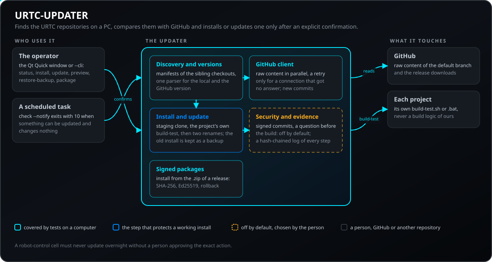
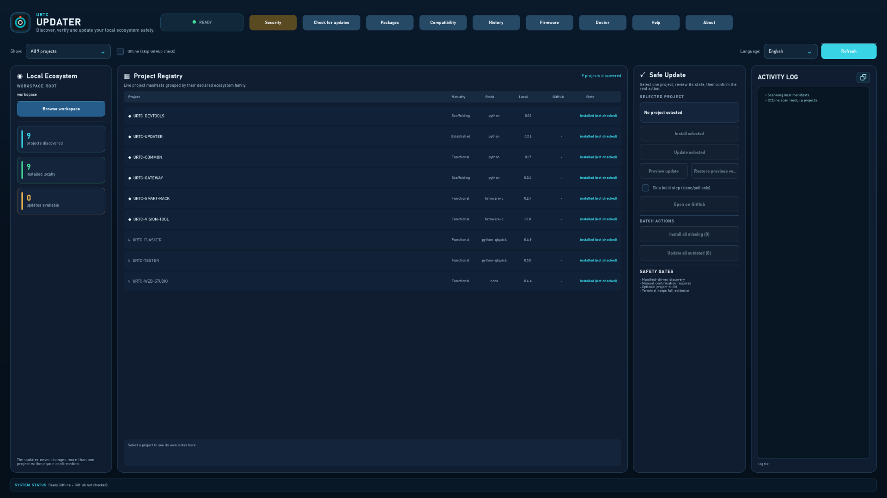
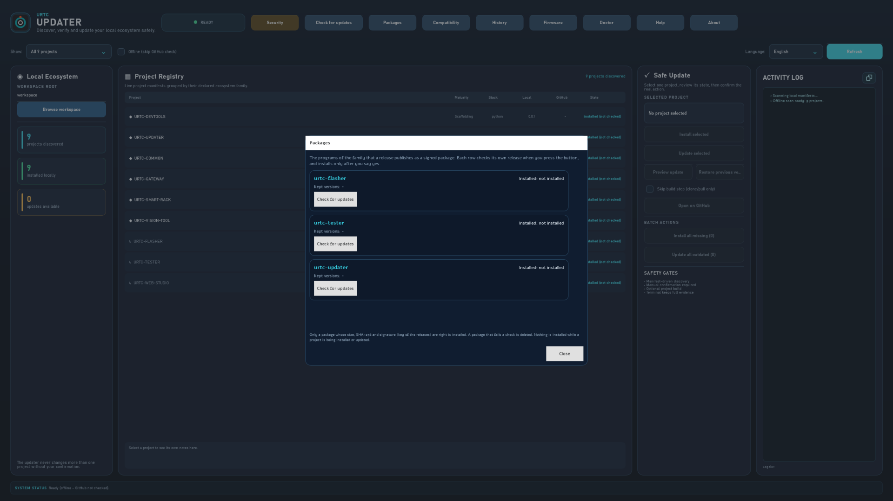
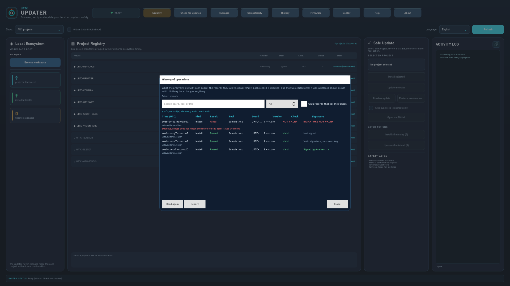
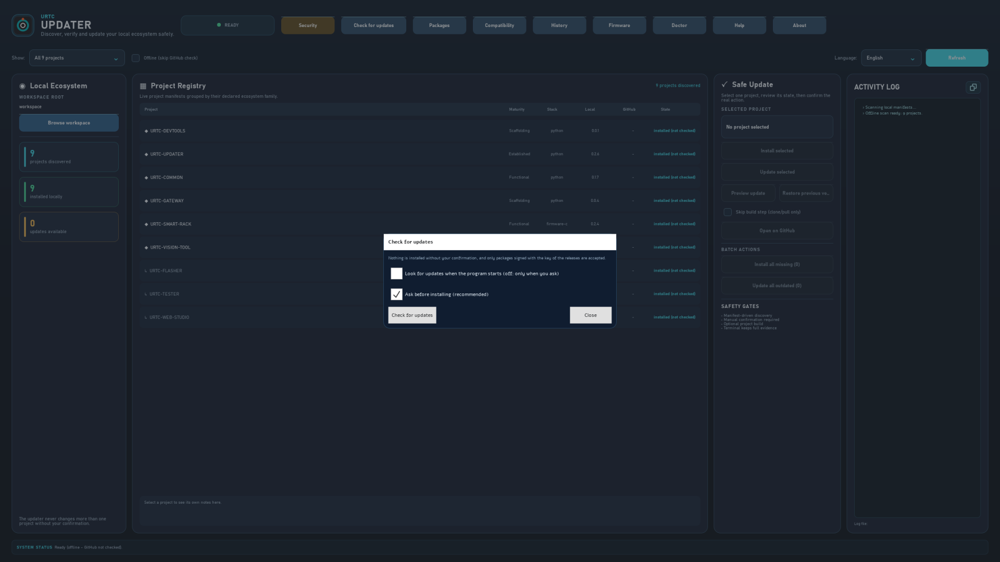
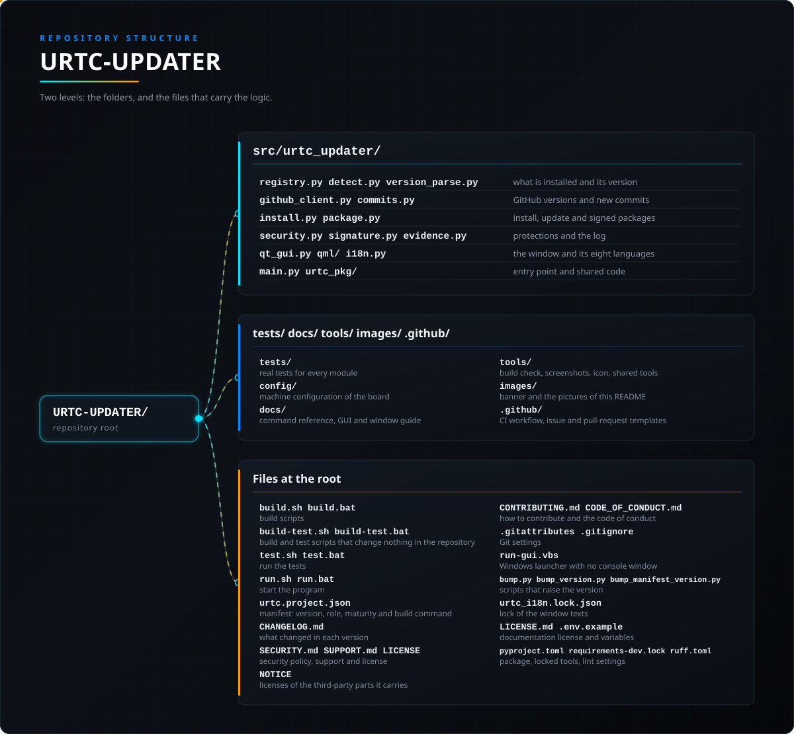

<p align="center">
  
</p>

# 🛠️ URTC-UPDATER

<p align="center"><a href="README.md">🇺🇸 English</a> | <a href="README_spa.md">🇪🇸 Español</a> | 🇫🇷 <b>Français</b> | <a href="README_ita.md">🇮🇹 Italiano</a> | <a href="README_deu.md">🇩🇪 Deutsch</a> | <a href="README_zho.md">🇨🇳 简体中文</a> | <a href="README_jpn.md">🇯🇵 日本語</a> | <a href="README_por.md">🇵🇹 Português</a></p>

### 📦 Détecte, installe et met à jour à la main tout l'écosystème URTC

<p align="center">
  
  
  
  
</p>

> **Mode bureau visuel :** l'interface bureau par défaut utilise maintenant
> **Qt Quick / QML** avec l'environnement d'exécution graphique optionnel `PySide6`. Le cœur et le
> mode `--cli` restent uniquement basés sur la bibliothèque standard pour une machine sans écran.
>
> **Démarrage Windows et preuves :** ouvrez `run-gui.vbs` (ou `run.bat` sans
> argument) pour le client graphique sans console. Le panneau de mise à jour
> affiche les étapes réelles de contrôle, source, manifeste, build-test et fin
> avec les preuves capturées ; `run.bat --cli ...` conserve le terminal de diagnostic.
> Installer n'est actif que sans copie locale et Mettre à jour seulement si GitHub
> est plus récent. Pendant une action approuvée, les points de contrôle remplacent les
> contrôles du projet ; choisir un autre projet les restaure.
> **Installer tous les manquants** et **Mettre à jour tous les dépassés** sont
> des actions par lot séquentielles, confirmées séparément et fondées sur le
> même état réel et parcours de sécurité.

---

**Point d'honnêteté : ce qui fonctionne réellement aujourd'hui :** **Maturité : établi (une exécution complète documentée, pas un usage soutenu).** Ce projet adapte la conception éprouvée de HYDRA-UMC-UPDATER (même découverte par manifeste, installation/mise à jour avec clone temporaire vérifié de façon atomique, journal de preuves) aux seuls dépôts de l'écosystème URTC. Il a été exécuté de bout en bout contre GitHub dans un espace de travail isolé : une installation propre puis une mise à jour d'un vrai dépôt ont été clonées, compilées et promues correctement, la copie précédente étant conservée comme sauvegarde. La logique de découverte et de versions (`registry.py`, `project_manifest.py`, `version_parse.py`, `detect.py`), le client du contenu brut (raw) de GitHub avec réessais et attente croissante et liste de dépôts en cache (`github_client.py`), la comparaison par commit (`commits.py`) et la chaîne cloner-préparer-vérifier-promouvoir (`install.py`) sont couverts par des tests (`python -m pytest`), dont un serveur HTTP de test local et de vrais dépôts git temporaires avec un dépôt distant local nu (bare). La logique propre au pont Qt s'exécute sans écran dans les tests, et la fenêtre avec ses dialogues est chargée sans écran pour vérifier qu'elle s'ouvre et répond ; son aspect est vérifié à l'œil, pas par un test. La couverture en 8 langues de `i18n.py` est vérifiée par test pour les clés et les paramètres, pas pour la qualité de la traduction. Voir `CHANGELOG.md` pour savoir exactement ce qui a été livré jusqu'ici.

---

> **État de la sûreté et de la cybersécurité :** cet écosystème n'est pas un système de sécurité certifié et aucune carte URTC assemblée n'existe encore. Les bootloaders contrôlent les images de firmware par CRC32 et un HMAC-SHA256 à clé partagée, pas par une signature asymétrique (prévue) ; les images d'application publiées sont signées avec la clé publique de développement (`signing_key_kind: dev`), si bien que n'importe qui peut produire une image acceptée par le bootloader ; rien n'a été transmis à une carte réelle. Lisez la [base de sécurité](https://github.com/JuanenRac/URTC-DOCS/blob/main/docs/SECURITY_BASELINE.md) et le [modèle de menaces](https://github.com/JuanenRac/URTC-DOCS/blob/main/docs/THREAT_MODEL.md) avant de vous fier à une affirmation de ce dépôt quant à la sécurité d'une personne.

## 📋 En un coup d'œil

| | |
|---|---|
| Version | `0.2.9` |
| Maturité | Établi |
| Tests | 721 (`python -m pytest`) |
| Technologie | Python 3.10+ / PySide6 / Qt Quick (QML) / Git / GitHub raw content |
| Cible | Le PC de la personne qui l'utilise |
| Sur matériel réel | Sans objet : rien ici ne s'exécute sur du matériel |

**Aller à :** [Présentation](#-présentation) · [Architecture](#-architecture) · [Sécurité](#-sécurité-et-protection) · [Interfaces](#-interfaces) · [Démarrage rapide](#-démarrage-rapide) · [Tests](#-tests) · [Dépannage](#-dépannage) · [Structure](#-structure-du-dépôt) · [Liés](#-projets-liés)

<!-- urtc-section:status_updater -->
## 🚦 État du projet

🟢 fait et vérifié · 🟡 fonctionne, avec des limites connues · 🟠 à moitié fait ou non vérifié · 🔴 non fait ou non fonctionnel. Rien n'est vert si cela n'a jamais tourné sur du vrai matériel.

| Partie | État | Ce que le dépôt peut démontrer |
| --- | :---: | --- |
| Logiciel | 🟡 | Fonctionne sur un PC et face au simulateur ; jamais utilisé avec une vraie carte. |
| Interface | 🟡 | La fenêtre fonctionne et est vérifiée face à une carte simulée ; non essayée avec un vrai adaptateur. |
| Tests | 🟢 | La suite de tests passe dans la CI à chaque push. |
| Mises à jour | 🟡 | Installe depuis des paquets signés avec retour en arrière ; essayé seulement sur PC. |
| Sécurité | 🟡 | Les versions sont signées en Ed25519 et vérifiées avant usage ; la gestion des clés n'a été relue par personne d'autre. |
| Langues et accessibilité | 🟡 | L'interface et son aide sont en huit langues ; l'usage au clavier et avec un lecteur d'écran n'a pas été testé |
| Documentation | 🟡 | README en huit langues et documents de référence ; les traductions n'ont pas été relues par des locuteurs natifs. |

<!-- /urtc-section:status_updater -->

## 🎯 Présentation

URTC-UPDATER est un petit outil : GUI avec fenêtre par défaut, CLI complète
avec `--cli`. Il est destiné à tourner sur la propre machine Windows/Linux/macOS
d'un développeur (n'importe quel espace de travail avec le même type de
copie locale) et répond à trois questions pour chaque autre projet réel qu'il
découvre grâce au manifeste `urtc.project.json` de chaque copie voisine. Le
nombre de projets n'est jamais codé en dur ici, car il croît avec
l'écosystème :

1. **Qu'est-ce qui est réellement installé ici, et dans quelle version ?**
2. **Quelle est la dernière version publiée sur GitHub ?**
3. **Si GitHub est plus récent, me laisser choisir un projet ou un lot séquentiel confirmé.**

Ce dernier point est délibéré et non négociable : cet outil ne modifie jamais
un projet de sa propre initiative. Une action sur un projet sélectionné exige
toujours une confirmation explicite. La GUI peut aussi proposer **Installer
tous les manquants** ou **Mettre à jour tous les dépassés** ; ce sont des lots
séquentiels confirmés séparément, soumis aux mêmes contrôles de manifeste, de
version et de sécurité. Il n'existe aucune mise à jour nocturne automatique.

Chaque dépôt URTC réel déclare `deployment_target: "user-pc"` - il n'existe pas
de rôle CM5/serveur dans cet écosystème, contrairement à HYDRA-UMC. Les dépôts de
firmware (URTC, URTC-SMART-RACK, URTC-VISION-TOOL) sont toujours compilés et flashés
DEPUIS un poste de travail, ils ne tournent simplement pas dessus ensuite ; le champ
`deploy` de `registry.py` l'enregistre (voir section 3), et le filtre du tableau de
projets de la GUI commence toujours sur « tout afficher », puisqu'aucun sous-ensemble
propre à une plateforme ne mérite d'être la valeur par défaut.

Exemple illustratif (le nombre exact de projets et chaque numéro de
version ci-dessous sont inventés pour la forme de la sortie, pas une
exécution réellement capturée - le vrai nombre est toujours ce que
`registry.py` découvre aujourd'hui, jamais un chiffre figé dans ce
document) :

```
$ urtc-updater --cli status
Workspace root: /home/user/GitHub
PROJECT       MATURITY     ROLE      STACK           LOCAL     GITHUB    STATE
-------------------------------------------------------------------------------
URTC          functional   firmware  firmware-c      0.3.0     0.3.1     OUTDATED
URTC-FLASHER  functional   tool      python-qtquick  0.2.1     0.2.1     up to date
URTC-TESTER   functional   tool      python-qtquick  0.2.2     0.2.2     NEW COMMITS

3/3 installed, 1 outdated, 1 with new commits at the same version
Run `urtc-updater update <project>` to update one by hand - never automatic, see this tool's own README.

$ urtc-updater --cli update URTC
Updating URTC into /home/user/GitHub ...
OK  Updated /home/user/GitHub/URTC to v0.3.1 (commit 1a2b3c4d5e6f) after a verified build; previous installation kept at /home/user/GitHub/URTC.backup-1a2b3c4d
```

Lancer `urtc-updater` sans argument (ou double-cliquer dessus) ouvre à la
place la même information dans une surface de contrôle de bureau sombre : un
panneau **Écosystème local** avec des métriques de découverte/installation/mise
à jour en direct, un arbre **Registre des projets** piloté par les manifestes et
un panneau **Mise à jour sûre** pour le projet sélectionné. La disposition rend
visibles les vraies protections : découverte par manifeste, une seule action
explicite sur un projet, confirmation manuelle, compilation optionnelle et une
trace d'activité à l'écran ; le journal complet est aussi écrit dans un
fichier sous `~/.urtc_updater/logs` (les 20 plus récents sont conservés).

## 🧩 Rôle dans URTC

URTC-UPDATER est le programme qui tient à jour un PC portant les dépôts URTC. Il trouve chaque projet à côté de lui grâce au manifeste que porte chaque dépôt, dit quelle version est installée et laquelle GitHub possède, et installe ou met à jour un projet à la fois après une confirmation explicite, en lançant le script `build-test` de ce projet sans rien compiler lui-même. Il ne change rien de sa propre initiative : une cellule de pilotage de robots ne doit jamais se mettre à jour la nuit sans qu'une personne approuve l'action exacte. Il installe aussi les programmes de bureau (le flasher, le tester et lui-même) à partir du paquet signé de leur release, et peut remettre à URTC-FLASHER, qui s'occupe du flashage, une image de firmware dont il a vérifié la signature de release.

## 🏛️ Architecture

<p align="center">
  
</p>

Comment les parties de ce dépôt s'articulent : qui l'utilise, ce qu'il contient et de quoi il dépend. L'image est dessinée à partir de `docs/architecture.json` et vérifiée par rapport au code.

### Comment fonctionne vraiment une vérification ou une mise à jour

- **Source de la version** : la version d'un projet vit dans un fichier source de ce projet (`pyproject.toml`, `Cargo.toml`, `version.go`, `package.json`, `version.properties`, `pubspec.yaml` ou un`#define` de firmware, selon sa technologie) qu'écrit sa propre étape `bump.py`, et cette étape n'a jamais créé de tag git ni de Release GitHub. Cet outil lit donc ce même fichier directement sur la branche par défaut du dépôt via l'hôte de contenu brut de GitHub, et non via l'API des Releases, qui signalerait que chaque projet n'a aucune release.
- **Détection locale** : pour chaque projet découvert, vérifie si
  un répertoire portant ce nom exact existe sous la racine de l'espace de travail
  (la disposition standard de l'écosystème - chaque projet en tant que
  répertoire voisin, exactement ce que supposent déjà les propres scripts de compilation
  d'URTC-FLASHER/URTC-TESTER), et si oui, lit sa propre
  copie locale de ce même fichier de version.
- **Une seule implémentation d'analyse** (`version_parse.py`) est
  partagée entre la lecture locale et la récupération GitHub, donc une
  copie locale et une récupération GitHub ne sont jamais interprétés
  par deux expressions régulières pouvant diverger indépendamment.
- **Installer/mettre à jour** : `git clone` (installation) compile
  ensuite comme une étape séparée. Mettre à jour une copie DÉJÀ
  EXISTANTE est atomique-par-vérification à la place : le candidat est
  cloné, fusionné en avance rapide (fast-forward) (jamais une réinitialisation forcée, donc de
  vraies modifications locales échouent de façon visible plutôt que d'être
  écrasées), puis construit/vérifié dans un clone de préparation
  entièrement indépendant D'ABORD - l'installation réelle n'est touchée
  (via deux renommages de répertoire consécutifs, l'installation
  précédente étant conservée dans `<nom>.backup-xxxxxxxx`, jamais supprimée) que
  si cette compilation de préparation réussit vraiment. Un échec de
  compilation, une copie divergente ou modifiée, un plantage ou un disque
  plein à n'importe quel moment avant cette promotion finale laissent
  l'installation précédente complètement intacte et toujours
  opérationnelle - voir la docstring propre de `clone_or_pull` dans
  `install.py`. Le dépôt distant git propre du clone de préparation est restauré
  vers le dépôt GitHub réel juste après sa création (un simple clone
  local le laisserait sinon pointer vers l'ancien chemin d'installation,
  mettant fin silencieusement à toutes les futures mises à jour une fois
  promu), et les données locales réelles propres à la copie installée
  (tout ce que git considère comme non suivi ou ignoré - `data/settings.json`
  et similaires, à l'exclusion des artefacts de compilation régénérables) sont
  transférées dans le clone de préparation avant sa compilation, afin que
  l'état opérationnel réel d'un projet survive à une mise à jour au lieu
  de rester bloqué dans la copie `.backup-xxxxxxxx` conservée. Dans tous les cas, cela exécute le `build-test.sh`/
  `build-test.bat` propre à ce projet (la vérification non-versionnante
  - voir section 3) s'il en a un. Cet outil ne réimplémente jamais les
  étapes de compilation propres à un projet.

### Architecture et décisions de conception

- **GUI Qt Quick par défaut, `--cli` pour une machine sans écran.** `main.py` vérifie
  `--cli` avant d'importer l'environnement d'exécution PySide6 optionnel, donc le mode CLI fonctionne
  sur une machine réellement sans écran, sans dépendance de bureau. Sans argument,
  il démarre le client QML là où l'environnement d'exécution est installé ; l'ancienne fenêtre Tkinter
  ne reste qu'un repli de compatibilité temporaire.
- **L'interface fenêtrée est réelle et parle 8 langues (`i18n.py`) - `--cli` volontairement non.** Chaque élément d'interface, ainsi que le texte de chaque point de contrôle et de chaque échec d'une installation ou mise à jour, s'affiche dans la langue choisie dans un sélecteur (en/es/fr/it/de/zh/ja/pt, portugais du Portugal pour pt), issue d'une préférence enregistrée ou de la langue du système. Les étapes d'installation et de mise à jour circulent sous forme de codes de message plus paramètres et seule la fenêtre les transforme en texte, si bien qu'un changement de langue les réaffiche. Les noms de projet et de famille et les textes `notes`/`tech` de chaque projet ne sont pas traduits : le manifeste est leur seule source de vérité. La sortie de `--cli` reste en anglais volontairement, car elle est faite pour être scriptée et redirigée.
- **`deploy` est une classification, pas une restriction.** Une première version de
  cette adaptation a recopié telle quelle la valeur par défaut de la GUI de
  HYDRA-UMC-UPDATER - filtre de déploiement sur `"cm5"` sous Linux - sans vérifier
  qu'aucun dépôt URTC réel ne déclare cette cible de déploiement (tous sont
  `"user-pc"` : le firmware est compilé et flashé DEPUIS un poste de travail, il n'y
  tourne jamais ensuite). La GUI se serait ouverte sur un tableau vide sous Linux.
  Corrigé : le filtre commence toujours sur « tout afficher », puisque cet écosystème
  n'a pas de rôle CM5/serveur à traiter à part. Le champ `deploy` de `registry.py`
  (« cm5 » / « user-pc » / « mobile » / « wearable » / « dev-server ») enregistre toujours la
  classification par manifeste de dépôt - il n'est simplement jamais utilisé comme
  valeur de démarrage.
- **Aucune logique de compilation par technologie dans cet outil.** L'écosystème couvre plusieurs chaînes d'outils (Python, Rust, Go, Node/TS, Android/Kotlin, Flutter, firmware ARM). Réimplémenter ici la compilation de chaque projet créerait un second endroit prétendant savoir le compiler, condamné à diverger du script du projet lui-même. `install.py` exécute à la place le `build-test.sh` sans versionnement du projet (`build-test.bat` sous Windows) et échoue de façon sûre si une copie n'en a pas. Les scripts de compilation qui incrémentent la version (`build.sh` et similaires) ne sont jamais lancés par cet outil.
- **Contenu brut de GitHub, pas l'API des Releases.** Voir la section 2 -
  la convention de versionnage de cet écosystème ne crée jamais de
  tag/release, donc l'API des Releases serait tout simplement fausse ici, pas
  seulement moins pratique.
- **Un échec réseau transitoire est réessayé ; une réponse
  définitive jamais.** Chaque requête GitHub réelle (`_urlopen_with_retries`
  de `github_client.py`) réessaie jusqu'à 3 fois avec une attente croissante, mais
  uniquement quand la connexion n'a jamais obtenu de réponse du tout
  (DNS/délai d'attente/reset). Un statut HTTP réel que GitHub a effectivement
  renvoyé - 404, 403, 500 - n'est jamais réessayé : GitHub a déjà
  répondu, et insister ne ferait que consommer davantage de quota pour le
  même résultat.
- **Un catalogue distant malformé échoue explicitement ; un seul projet
  malformé non.** Si la liste des dépôts GitHub elle-même est
  injoignable ou illisible, `discover_remote_projects()` lève une
  exception et le pont de bureau retombe sur la liste de projets découverts
  localement plutôt que d'afficher un scan cassé ou vide. Le manifeste
  malformé d'un seul dépôt, en revanche, est isolé dans la liste `errors` de
  ce scan et n'interrompt jamais la découverte du reste - un vrai test avec
  serveur de test (`tests/test_github_client.py`) prouve les deux chemins.
- **La CLI reste explicite ; les lots GUI restent confirmés.** Les commandes
  CLI `install`/`update` prennent un nom de projet. La GUI peut exécuter
  **Installer tous les manquants** ou **Mettre à jour tous les dépassés**,
  uniquement après confirmation séparée et de façon séquentielle par les mêmes
  contrôles de sécurité. Aucune mise à jour automatique non surveillée n'existe.
- **Bibliothèque standard uniquement.** `urllib` pour les récupérations
  GitHub (`github_client.py`), `subprocess` pour les appels git/scripts
  de compilation (`install.py`), rien d'autre - qu'un outil responsable de
  maintenir saines les dépendances de TOUS les autres projets reste
  lui-même sans dépendances est délibéré.
- **Simplification connue :** un dépôt composé de plusieurs binaires versionnés indépendamment (URTC en a quatre : principal et esclave, application et bootloader) est suivi par UNE seule version, celle que son propre `urtc.project.json` déclare dans `native_version`. Cela répond à « ce dépôt est-il à peu près à jour ? », pas à la vérification de version par composant d'un flashage.

<!-- urtc-section:updates -->
### Comment il se met à jour

Ce programme peut chercher une version plus récente de lui-même : le bouton « Rechercher une mise à jour » interroge GitHub une fois et ne propose un paquet signé que s'il est pour votre système et plus récent. Rien n'est vérifié ni installé tout seul tant que vous n'activez pas la vérification, et une mise à jour demande votre confirmation. Le paquet doit correspondre à son SHA-256 et à la signature de la clé des releases épinglée dans le programme ; la version précédente est conservée et rétablie d'elle-même si la nouvelle ne démarre pas. `urtc-updater --cli package list|check|install|rollback` fait la même chose en ligne de commande pour le flasher et le tester, et `install --file` fonctionne sans réseau.
<!-- /urtc-section:updates -->

<!-- urtc-section:screenshots -->
## 🖼️ Captures d'écran

Capturées sur un banc d'essai avec des données d'exemple fictives et sans installation réelle derrière.

<p align="center">
  
</p>

<p align="center"><em>La fenêtre sur un espace de travail contenant la famille : chaque projet avec sa maturité, sa pile et sa version locale, et les actions de mise à jour sûres.</em></p>

<p align="center">
  
</p>

<p align="center"><em>La fenêtre des paquets : les programmes de la famille qu'une version publie comme paquet signé, chacun vérifiant sa propre version.</em></p>

<p align="center">
  
</p>

<p align="center"><em>La fenêtre de l'historique : tous les enregistrements que les programmes ont écrits pour chaque carte, le plus récent d'abord, chacun vérifié séparément, avec une colonne Signature qui dit s'il est signé, par laquelle de vos clés, ou s'il n'est pas valide.</em></p>

<p align="center">
  
</p>

<p align="center"><em>La fenêtre de mise à jour : un paquet signé plus récent n'est installé qu'après votre confirmation.</em></p>
<!-- /urtc-section:screenshots -->

## 🔒 Sécurité et protection

| Menace | Défense |
|---|---|
| Une mise à jour que personne n'a approuvée, par exemple la nuit sur une cellule de robots | Rien ne change tout seul : une action sur un projet exige une confirmation explicite, un lot est confirmé à part et s'exécute projet par projet |
| Une mise à jour cassée ou à moitié faite rend inutilisable une installation qui fonctionnait | Le candidat est cloné, fusionné en avance rapide (jamais une réinitialisation forcée, si bien que les modifications locales échouent de façon visible) et compilé d'abord dans un clone de préparation ; l'installation en service n'est remplacée, par deux renommages de dossier, que si cette compilation réussit, et la précédente est gardée sous `<nom>.backup-xxxxxxxx` |
| Une vérification qui ne peut pas être lancée ici | Un build-test qui répond 75 signifie que la validation est indisponible : la mise à jour est refusée sauf si la personne l'accepte dans les réglages |
| Un commit que personne n'a signé | Une révision sans signature valide est refusée par défaut ; avec `"signature_policy": "warn"` elle est installée avec un avertissement |
| Un paquet manipulé | Un paquet n'est accepté que si sa taille, son SHA-256 et sa signature Ed25519 correspondent et s'il vient des hôtes de téléchargement de GitHub ; il n'est installé qu'après confirmation, jamais pendant qu'une autre installation tourne, et la version précédente peut être restaurée |
| La trace de ce qui a été fait se perd | Chaque installation, mise à jour et restauration est écrite, avec l'heure, la machine et l'utilisateur, dans un journal chaîné par des hachages |

Le reste de la politique suit, dans les mots du programme.

**Ce que le build-test peut répondre :** le code de sortie 0 signifie validé et tout autre code signifie échec, sauf 75, qui signifie que la validation est *indisponible* (un outil nécessaire n'est pas installé). C'est signalé comme tel et la mise à jour est refusée, sauf si vous l'acceptez en réglant `validation_unavailable` sur `accept` dans les réglages (ou `URTC_UPDATER_ACCEPT_UNAVAILABLE_VALIDATION=1`). Un build-test doit laisser l'arbre comme il l'a trouvé : s'il modifie un fichier suivi par git, le fichier est remis au contenu validé avant la promotion et les étapes indiquent lequel.

**Commits signés (exigés par défaut ; revenir à un simple avertissement est un choix explicite) :** une révision sans signature valide (`git verify-commit` : trousseau GPG, ou SSH avec `"allowed_signers_file"` / `URTC_UPDATER_ALLOWED_SIGNERS`) est refusée. Avec `"signature_policy": "warn"` dans `~/.urtc_updater_settings.json` (ou `URTC_UPDATER_REQUIRE_SIGNED=0`, ou `--no-require-signed` pour une exécution ; l'ancien `"require_signed_commits": false` signifie la même chose) elle est installée quand même, et les étapes de la fenêtre et de la ligne de commande indiquent qu'elle n'est pas signée. Avec la valeur par défaut (`"signature_policy": "require"` ou `URTC_UPDATER_REQUIRE_SIGNED=1` ; l'ancien `"require_signed_commits": true` signifie la même chose) le candidat - le `HEAD` d'un clone neuf ou le `FETCH_HEAD` récupéré d'une mise à jour - doit passer `git verify-commit` avant la lecture de son manifeste ou tout build, et un candidat refusé laisse le checkout installé intact.

**Options de sécurité (toutes deux activées par défaut ; modifiables avec le bouton Sécurité de la fenêtre, la commande `security`, le fichier de réglages, l'environnement et la ligne de commande) :** en plus d'exiger des commits signés, l'outil peut *demander avant d'exécuter la vérification de build* d'un candidat (`"confirm_before_build": true`, la valeur par défaut ; `URTC_UPDATER_CONFIRM_BUILD=1`, `--confirm-build`). Il récupère et valide le candidat, montre le projet, le commit, son auteur, sa signature et les scripts de build ou d'outils modifiés, et n'exécute rien tant que vous n'avez pas répondu ; sans fenêtre ni terminal à qui demander, il échoue de façon sûre : il n'exécute rien, n'installe rien et dit comment répondre. Les exécutions sans surveillance répondent oui explicitement avec `--yes`, `URTC_UPDATER_ASSUME_YES=1` ou le réglage « assume_yes_without_asking » : true (désactivé par défaut). Avec `"signature_policy": "warn"` et `"confirm_before_build": false`, on revient au comportement précédent. `--require-signed` / `--no-require-signed` et `--confirm-build` / `--no-confirm-build` valent pour une seule exécution, et une exécution qui désactive une protection activée dans les réglages enregistrés le signale ; la fenêtre, et `urtc-updater --cli security --require-signed off`, demandent confirmation avant d'enregistrer un niveau plus bas. Un fichier de réglages qui existe mais ne peut pas être lu compte comme « signatures exigées » tant qu'il n'est pas réparé ou supprimé. La vérification de build reçoit aussi `URTC_PYTHON`, l'interpréteur qui exécute l'outil, afin qu'un projet teste avec ce Python et non avec celui que le système trouve en premier.

## 🔌 Interfaces

Le programme ouvre la fenêtre Qt Quick quand on le lance sans argument et offre une ligne de commande complète avec `--cli` (sans écran ni PySide6) : `status [--offline]`, `install PROJET`, `update PROJET [--preview]`, `restore-backup PROJET [--list]`, `clean-backups [--keep N] [--dry-run]`, `check [--notify] [--quiet]` (code de sortie 10 quand quelque chose peut être mis à jour), `package list|check|install|rollback`, `evidence [--export FILE]` et `security`. Chaque commande, option et code de sortie, avec une vraie sortie, est dans [docs/CLI_REFERENCE.md](docs/CLI_REFERENCE.md) ; la fenêtre est décrite dans [docs/QML_DESKTOP_GUI.md](docs/QML_DESKTOP_GUI.md). Ce que font les commandes d'entretien et de poste :

- **Installations précédentes conservées.** Chaque mise à jour garde l'installation qu'elle remplace dans `<nom>.backup-xxxxxxxx`. Les 2 plus récentes par projet sont conservées (`"backups_to_keep"` dans `~/.urtc_updater_settings.json` change ce nombre) et les plus anciennes sont supprimées après une mise à jour réussie. `urtc-updater --cli clean-backups [--keep N] [--dry-run]` les supprime à la demande, ainsi que tout dossier temporaire caché laissé par une exécution interrompue.
- **En option, installation depuis le paquet signé d'une release.** `urtc-updater --cli package list|check|install|rollback` installe un programme (le flasher, le tester ou cet updater) depuis le `.zip` / `.tar.gz` de sa release, au lieu d'un clone et d'une compilation. Seule une version strictement supérieure est proposée, uniquement depuis les hôtes de téléchargement de GitHub, et le paquet doit correspondre à la taille et au SHA-256 annoncés et à la signature Ed25519 de la clé des releases épinglée dans le programme ; un paquet qui échoue à une vérification est supprimé. Il demande avant d'installer (`--yes` répond pour les scripts), conserve les deux dernières releases et `rollback` revient à la précédente. `install --file PAQUET` fonctionne depuis un fichier sur le disque avec son `.sha256` et son `.sig` à côté, sans réseau. La fenêtre a un bouton « Rechercher une mise à jour » pour l'updater lui-même, avec les mêmes règles ; la vérification automatique au démarrage est une option, désactivée par défaut. Testé avec des paquets générés sur un ordinateur, pas encore avec une release publiée.
- **Une fenêtre Paquets et une fenêtre Aide.** Le bouton « Paquets » liste les paquets signés du flasher, du tester et de cet updater : chaque ligne vérifie sa version quand vous appuyez sur « Rechercher une mise à jour », télécharge et vérifie le paquet, demande avant d'installer et revient à la version précédente, avec les mêmes règles et options de sécurité que la commande `package` ; rien n'est installé pendant l'installation ou la mise à jour d'un projet. Le bouton « Aide » ouvre un guide en cinq étapes dans la langue de la fenêtre.
- **En restaurer une.** `urtc-updater --cli restore-backup <PROJET> [--backup DOSSIER] [--list]` remet en place une installation conservée. L'installation remplacée est conservée aussi, donc l'échange peut être annulé. La fenêtre propose les deux mêmes actions à côté de Mettre à jour la sélection : Aperçu de la mise à jour (ce qu'elle apporterait, sans rien modifier) et Restaurer la version précédente.
- **Même version, nouveaux commits.** La version ne change que lors d'une compilation de publication ; `status` compare donc aussi le commit de chaque projet installé à celui du distant (`git ls-remote`) et affiche `NEW COMMITS` quand GitHub a du travail que la copie n'a pas. La fenêtre affiche le même état et propose la mise à jour.
- **Regarder avant d'approuver.** `urtc-updater --cli update <PROJET> --preview` récupère le candidat et affiche son commit, son auteur, sa version, l'état de sa signature et les fichiers de compilation ou d'outils qu'il modifie, sans toucher à la copie.
- **Notifier seulement.** `urtc-updater --cli check [--notify] [--quiet]` liste ce qui pourrait être mis à jour et ne change rien. Il se termine avec le code 10 quand quelque chose peut l'être, afin qu'une tâche planifiée prévienne une personne ; `--notify` affiche aussi une notification de bureau.
- **Preuves.** Chaque installation, mise à jour et restauration est consignée avec l'heure, la machine et l'utilisateur dans `.urtc-updater/evidence.jsonl`, chaque ligne étant chaînée à la précédente par hash. `urtc-updater --cli evidence [--export FICHIER]` vérifie la chaîne et peut l'exporter en un seul document JSON.
- **Profils de poste.** `"profiles"` dans le fichier de réglages nomme les projets d'une machine et si les lots sont autorisés ; `--profile NOM` (ou `"profile"` dans les réglages) y limite `status`, `check`, `install` et `update`, et la fenêtre suit le même profil.

- **Historique des tentatives.** Le bouton **Historique** de la barre du haut montre les tentatives d'installation et de mise à jour de l'espace de travail comme des enregistrements de preuve (`urtc-evidence/1`) ; le fichier de preuve avec sa chaîne de hachages reste tel quel et la fenêtre travaille sur une seconde vue dans `.urtc-updater/common`. Chaque ligne indique le type, le résultat, l'outil, la carte et les versions, du plus récent au plus ancien ; un enregistrement modifié après son écriture, un fichier qui n'est pas du JSON ou un enregistrement d'un autre format est affiché comme non valide, avec ce qui ne va pas. La liste peut être filtrée par résultat et par texte ou réduite aux enregistrements en échec ; elle relit le dossier à chaque ouverture, affiche au plus 500 lignes (et indique combien il y en a) et ne modifie rien sur le disque. C'est la même fenêtre dans URTC-FLASHER, URTC-TESTER et URTC-UPDATER, partagée depuis URTC-COMMON, dans les huit langues. En ligne de commande, `urtc-updater --cli evidence --history FOLDER [--json]` liste les enregistrements d'un dossier, vérifie chacun et se termine avec le statut 1 si l'un n'est pas valide ; il ne fait que lire.

- **Une fenêtre Firmware et `firmware sync`.** Le bouton **Firmware** demande une image de firmware (une zone et un sélecteur de fichier), vérifie sa signature de version sur demande et ouvre le Flasher installé avec l'image sélectionnée, avec les mêmes règles que `firmware check` et `firmware open` : une signature absente ou fausse est refusée, le motif est donné dans la langue de la fenêtre et rien n'est écrit sur une carte depuis ici. En option, `urtc-updater --cli firmware sync [--dry-run] [--yes]` copie l'image la plus récente de chaque type de `URTC/firmware` vers `URTC-FLASHER/firmware` après avoir vérifié chacune avec la signature de version, montre ce qu'il va faire et demande d'abord (sans terminal, rien n'est copié) ; les images remplacées sont déplacées dans l'espace de travail, jamais supprimées. `--option on` fait finir `update URTC` par la même question ; l'option est désactivée par défaut.

## 🚀 Démarrage rapide

```bash
chmod +x build.sh   # une seule fois
./build.sh          # crée .venv, pip install -e ., compile-check de tout
./run.sh                              # GUI avec fenêtre (par défaut)
./run.sh --cli status                 # ce qui est installé, version locale vs. GitHub
./run.sh --cli status --offline       # pareil, sans vérifier GitHub
./run.sh --cli install <NOM-PROJET>   # clone + compile un projet pas encore installé
./run.sh --cli update  <NOM-PROJET>   # met à jour + recompile un projet déjà installé
```

Sous Windows : `build.bat`, puis `run.bat` (GUI) / `run.bat --cli status`
/ `run.bat --cli install <nom>` / `run.bat --cli update <nom>`.

La GUI recommandée requiert l'environnement d'exécution Qt optionnel (`pip install -e ".[gui]"`;
`build.bat`/`build.sh` l'installent déjà). `--cli` n'a pas de dépendance GUI et
convient à une machine sans écran. Sans Qt, l'ancienne fenêtre Tkinter reste un
repli de compatibilité uniquement.

<!-- urtc-section:compatibility -->
### Prérequis et compatibilité

Les versions des programmes URTC qui fonctionnent ensemble, et la version du protocole que parle chacune, figurent dans le tableau de compatibilité que génère URTC-COMMON : [docs/COMPATIBILITY.md](https://github.com/JuanenRac/URTC/blob/main/docs/COMPATIBILITY.md). Les notes d'une version des dépôts qui portent `tools/changelog_section.py` (le firmware, le flasher, le tester et l'updater) sont la section du CHANGELOG de cette version suivie de ce tableau : `python tools/changelog_section.py VERSION --compat`.
<!-- /urtc-section:compatibility -->

## 🧪 Tests

La suite compte 695 tests (`QT_QPA_PLATFORM=offscreen python -m pytest tests -q` ; quelques-uns sont ignorés quand une dépendance optionnelle manque) : la découverte et les manifestes, l'unique analyseur de versions, le client GitHub face à un serveur local (nouvelles tentatives, erreurs, un catalogue mal formé), l'installation et la mise à jour sur de vrais dépôts git locaux (préparation, promotion, sauvegarde, refus, un build-test qui répond 75, sécurité de l'espace de travail), la restauration et le nettoyage des sauvegardes, la politique de commits signés, les options de sécurité, les paquets signés et leur retour arrière, la chaîne de preuves, les réglages et profils, les textes de la fenêtre dans les huit langues et le pont Qt, et les images du guide de la fenêtre, dessinées sans écran. `python -m mypy` et `ruff check .` tournent en CI.

## 🏗️ Compilation et publication

`build.sh` / `build.bat` créent le `.venv`, installent le paquet (`pip install -e .`, avec l'environnement Qt pour la fenêtre) et vérifient la compilation de tout ; `build-test.sh` / `build-test.bat` vérifient sans installer ; `run.sh` / `run.bat` ouvrent la fenêtre, ou la ligne de commande avec `--cli` ; `run-gui.vbs` l'ouvre sous Windows sans fenêtre de console. Un exécutable autonome empaqueté n'est pas encore construit.

## 🩺 Dépannage

- `status` affiche `?` pour la version GitHub d'un projet : GitHub n'a pas pu être lu pour lui. La colonne STATE dit pourquoi (par exemple `installed, GitHub unknown (HTTP 404)` ou un avis de limite de requêtes).
- `status` affiche `-` pour GitHub sans erreur affichée : lancez `status`
  (sans `--offline`) - `-` n'apparaît que quand la vérification GitHub a
  été complètement sautée.
- `install`/`update` échoue avec « No non-versioning build-test.sh/.bat found » : cette copie n'a pas de `build-test.sh` (`build-test.bat` sous Windows). Mettez à jour le projet lui-même ou vérifiez-le à la main ; cet outil ne lance jamais à la place un script de compilation qui incrémente la version.
- `git pull --ff-only` échoue : la copie locale a des modifications non
  commitées ou l'historique a divergé - résolvez cela manuellement (`git
  status` dans le répertoire propre du projet) avant de réessayer
  `update`. Cet outil ne force jamais une réinitialisation d'une copie locale.

## 📂 Structure du dépôt

<p align="center">
  
</p>

<details>
<summary>Version texte de l'arborescence</summary>

```text
URTC-UPDATER/
├── src/urtc_updater/                                  le programme : découverte, versions, installation et mise à jour, sécurité, paquets signés, la fenêtre Qt Quick et ses textes en huit langues
├── tests/                                             de vrais tests pour chaque module
├── docs/                                              référence des commandes, interface et guide de la fenêtre
├── tools/                                             contrôle de compilation, captures, icône et outils partagés
├── images/                                            bannière et images de ce README
├── .github/                                           workflow de CI et modèles d'issues et de pull requests
├── build.sh build.bat                                 scripts de compilation
├── build-test.sh build-test.bat                       scripts de compilation et de test qui ne changent rien dans le dépôt
├── test.sh test.bat                                   lancent les tests
├── run.sh run.bat                                     lancent le programme
├── urtc.project.json                                  manifeste : version, rôle, maturité et commande de compilation
├── CHANGELOG.md                                       ce qui a changé à chaque version
├── SECURITY.md SUPPORT.md LICENSE                     politique de sécurité, assistance et licence
├── NOTICE                                             licences des parties tierces qu'il contient
├── CONTRIBUTING.md CODE_OF_CONDUCT.md                 comment contribuer et code de conduite
├── .gitattributes .gitignore                          réglages Git
├── run-gui.vbs                                        lanceur Windows sans fenêtre de console
├── bump.py bump_version.py bump_manifest_version.py   scripts qui augmentent la version
├── urtc_i18n.lock.json                                verrou des textes de la fenêtre
├── LICENSE.md .env.example                            licence de la documentation et variables
└── pyproject.toml requirements-dev.lock ruff.toml     paquet, outils figés, réglages de lint
```

</details>

La liste annotée de chaque fichier source, une ligne par fichier, est dans [docs/SOURCE_MAP.md](docs/SOURCE_MAP.md).

## 🗺️ Feuille de route et limites connues

- Un exécutable GUI autonome empaqueté (PyInstaller, suivant la propre
  convention `build_exe.bat`/`.sh` d'URTC-FLASHER/URTC-TESTER) pour une
  installation en double-clic sans aucune étape `pip`/venv - aujourd'hui
  la GUI a encore besoin de `./build.sh` d'abord, comme la CLI.
- Vérification préalable optionnelle des dépendances par projet (signaler
  l'absence d'une chaîne d'outils arm-none-eabi-gcc/Node avant qu'un `install`
  échoue en cours de route).
- Suivi par composant pour le firmware multi-binaire propre d'URTC
  (voir la « simplification connue » de la section 3), dès
  qu'un besoin réel se fera sentir au-delà du seul composant
  représentatif suivi aujourd'hui.

## 🌍 Langues

Le README et les textes existent en anglais, espagnol, français, italien, allemand, chinois, japonais et portugais européen.

## 🔗 Projets liés

URTC est fait de dépôts indépendants, chacun avec sa version, ses tests et son README. Voici la famille, par groupes :

* **URTC Tool Platform:**
  * [URTC](https://github.com/JuanenRac/URTC) - firmware de la carte de la tête d'outil (25 profils d'outil, bootloader CAN) et référence du protocole CAN.
  * [URTC-COMMON](https://github.com/JuanenRac/URTC-COMMON) - le protocole CAN écrit une seule fois comme données (spécification, tables générées, vecteurs de conformité) et le code que les programmes partagent.
  * [URTC-FLASHER](https://github.com/JuanenRac/URTC-FLASHER) - outil de bureau qui met à jour le firmware de la carte par CAN ou par SWD/JTAG.
  * [URTC-GATEWAY](https://github.com/JuanenRac/URTC-GATEWAY) - passerelle devant le bus CAN : ne laisse passer que les identifiants d'une liste, limite leur cadence et demande une clé de session.
  * [URTC-SMART-RACK](https://github.com/JuanenRac/URTC-SMART-RACK) - logique C indépendante du matériel et protocole de commandes pour un support d'outils avec préchauffage et suivi du cycle de vie.
  * [URTC-TESTER](https://github.com/JuanenRac/URTC-TESTER) - tester de bureau du bus CAN en direct qui affiche les commandes et la télémétrie du profil d'outil signalé par une carte.
  * [URTC-VISION-TOOL](https://github.com/JuanenRac/URTC-VISION-TOOL) - protocole de trames de capteur en C et compagnon Python thermique/RGB pour une tête d'outil d'inspection.
  * [URTC-WEB-STUDIO](https://github.com/JuanenRac/URTC-WEB-STUDIO) - application de navigateur qui flashe et teste la carte via Web Serial et SLCAN, sans rien installer.
* **Ecosystem Operations:**
  * [URTC-DEVTOOLS](https://github.com/JuanenRac/URTC-DEVTOOLS) - les outils de dépôt communs de la famille en un ensemble versionné, avec un fichier de verrouillage qui distingue une copie modifiée d'une copie en retard.
  * [URTC-DOCS](https://github.com/JuanenRac/URTC-DOCS) - architecture, interfaces, base de sécurité et catalogue généré de l'écosystème, plus les outils qui comparent tous les dépôts.
  * **URTC-UPDATER** (ce dépôt) - outil de bureau qui détecte, installe et met à jour les dépôts de la famille URTC, une action explicite à la fois.

**Projets frères (indépendants, avec la même base et les mêmes outils) :**

* **[HYDRA-UMC-DOCS](https://github.com/JuanenRac/HYDRA-UMC-DOCS)** - projet frère : le centre de documentation de HYDRA-UMC, un écosystème indépendant qui partage la base et les outils de celui-ci
* **[ARMOR-DOCS](https://github.com/JuanenRac/ARMOR-DOCS)** - projet frère : le centre de documentation d'A.R.M.O.R., l'écosystème de sécurité, lui aussi indépendant et construit sur la même base
* **[JuanenRac](https://github.com/JuanenRac/JuanenRac)** - le profil et le tableau d'état de tous les écosystèmes

## 📚 Documentation

- **[docs/WINDOW_GUIDE.md](docs/WINDOW_GUIDE.md)** — un guide de la fenêtre avec des images : la fenêtre principale, l'aide et la fenêtre de mise à jour.
- **[docs/CLI_REFERENCE.md](docs/CLI_REFERENCE.md)** — chaque sous-commande `--cli`, sortie réelle capturée depuis une installation réelle, et le contrat des codes de sortie.
- **[docs/QML_DESKTOP_GUI.md](docs/QML_DESKTOP_GUI.md)** — comment le client de bureau Qt Quick/QML est structuré, et comment il reste une vraie surface de contrôle sur le même backend que `--cli` utilise, pas une seconde implémentation.
- **[Historique des modifications de ce dépôt](CHANGELOG.md)**
- Questions, idées et rapports : electrohobby3d@gmail.com

## 🤝 Contribuer et communauté

* Avant une pull request, lancez `URTC_CI=1 python tools/ci_validate.py` : il doit réussir. Voir [CONTRIBUTING.md](CONTRIBUTING.md) et le [code de conduite](CODE_OF_CONDUCT.md).
* Le README existe en huit langues : une modification du texte se fait dans les huit fichiers, et les sections partagées avec d'autres dépôts sont écrites par `tools/readme_sections.py` d'URTC-COMMON.
* Un changement du protocole CAN commence dans URTC-COMMON (`spec/can_protocol.json`) et arrive dans ce dépôt par la copie vérifiée.
* Ne décrivez pas comme fonctionnant sur une carte ce qui a seulement été compilé.
* Signalez une vulnérabilité en privé : [SECURITY.md](SECURITY.md). Questions, idées et rapports : electrohobby3d@gmail.com ([SUPPORT.md](SUPPORT.md)).

## 👤 AUTEUR

**JuanenRac** (Electro Hobby 3D)
📧 electrohobby3d@gmail.com
📺 [youtube.com/@electrohobby3d](https://youtube.com/@electrohobby3d)

## 📜 LICENCE

GPL-3.0-or-later - voir [LICENSE](LICENSE).
