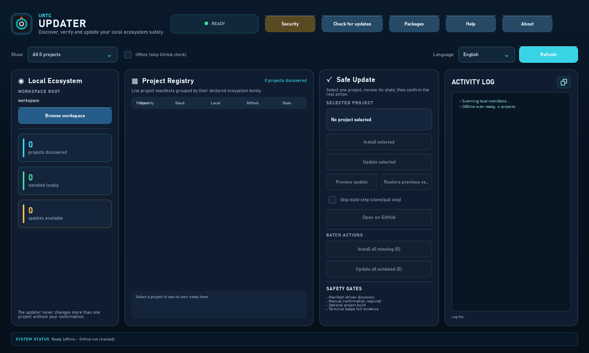

<p align="center">
  
</p>

# 🛠️ URTC-UPDATER

<p align="center"><a href="README.md">🇺🇸 English</a> | <a href="README_spa.md">🇪🇸 Español</a> | <a href="README_fra.md">🇫🇷 Français</a> | <a href="README_ita.md">🇮🇹 Italiano</a> | <a href="README_deu.md">🇩🇪 Deutsch</a> | <a href="README_zho.md">🇨🇳 简体中文</a> | 🇯🇵 <b>日本語</b> | <a href="README_por.md">🇵🇹 Português</a></p>

### 📦 URTC エコシステム全体の検出、インストール、手動更新

<p align="center">
  
  
  
  
</p>

> **ビジュアルデスクトップモード：** 既定のデスクトップ画面は、任意の
> `PySide6` GUI ランタイムを通じて **Qt Quick / QML** を使用します。更新コアと
> `--cli` はヘッドレス CM5 向けに標準ライブラリのみを維持します。
>
> **Windows 起動と証跡：** `run-gui.vbs` をダブルクリックするか、引数なしの
> `run.bat` を実行するとコンソールなしの GUI が起動します。更新パネルには、
> 実際の事前確認、ソース更新、マニフェスト検証、ビルドテスト、完了のチェックポイントと
> 取得した証跡を表示します。`run.bat --cli ...` は診断用ターミナルを維持します。
> インストールはチェックアウトがない場合だけ、更新は GitHub が新しい場合だけ有効です。
> 承認済み操作中はチェックポイントがプロジェクト操作を置き換え、別のプロジェクトを
> 選ぶと操作を復元します。
> **不足分をすべてインストール**と**古い項目をすべて更新**は、同じ実際の状態と
> 安全経路に基づく、別途確認される順次一括アクションです。

**正直な現状確認 - 実際に今動くもの:** **成熟度: established（確立。ただし記録されているのは 1 回の通しの実行であり、継続的な使用ではありません）。** このプロジェクトは HYDRA-UMC-UPDATER で実績のある設計（同じマニフェスト検出、原子的に検証される一時クローンによるインストール/更新、証跡ログ）を、URTC エコシステムのリポジトリだけに適用したものです。隔離したワークスペースで GitHub に対してエンドツーエンドで実行済みです。クリーンインストールと、その後の実リポジトリの更新が、正しくクローン、ビルド、昇格され、以前のコピーはバックアップとして残りました。検出とバージョンのロジック（`registry.py`, `project_manifest.py`, `version_parse.py`, `detect.py`）、リトライ/バックオフとリポジトリ一覧のキャッシュを備えた GitHub raw-content クライアント（`github_client.py`）、コミット比較（`commits.py`）、clone-stage-verify-promote パイプライン（`install.py`）は、ローカルの HTTP テストサーバーや、ローカルの bare リモートを持つ実際の一時 git リポジトリを含むテスト（`python -m pytest`）で検証されています。Qt ブリッジ自体のロジックはテストで画面なしに実行され、ウィンドウとそのダイアログも画面なしで読み込んで、開いて応答することを確認します。見た目は目視で確認しており、テストはありません。`i18n.py` の 8 言語対応は、キーとプレースホルダーの一致をテストで強制していますが、翻訳の品質は検証していません。これまでに実際に提供したものは `CHANGELOG.md` を参照してください。

---

> **安全性とセキュリティの現状:** このエコシステムは認証された安全システムではなく、実装済みの URTC 基板もまだ存在しません。ブートローダーはファームウェアイメージを CRC32 と共有鍵の HMAC-SHA256 で検査しており、非対称署名ではありません(予定)。公開されているアプリケーションイメージは公開の開発用鍵(`signing_key_kind: dev`)で署名されているため、誰でもブートローダーが受け入れるイメージを作れます。実際の基板には何も送信されていません。ここに書かれた内容を人の安全のために頼る前に、[セキュリティベースライン](https://github.com/JuanenRac/URTC-DOCS/blob/main/docs/SECURITY_BASELINE.md)と[脅威モデル](https://github.com/JuanenRac/URTC-DOCS/blob/main/docs/THREAT_MODEL.md)をお読みください。

## 📋 ひと目で

| | |
|---|---|
| バージョン | `0.1.7` |
| 成熟度 | 確立 |
| 技術 | Python 3.10+ / PySide6 / Qt Quick (QML) / Git / GitHub raw content |
| 対象 | 利用者の PC |
| 実機での確認 | 対象外：ここにあるものはハードウェア上では動きません |

## 1. 🛠️ 技術概要

URTC-UPDATER は、小さなツールです——デフォルトはウィンドウ付き
GUI、`--cli` で完全な CLI が利用可能——実際の CM5 本体上、または開発者
自身の Windows/Linux/macOS マシン（同じ方法でチェックアウトされた任意の
ワークスペース）で実行されることを意図しており、各隣接チェックアウト
自身の `urtc.project.json` マニフェストを通じて発見する、他の
すべての実在するプロジェクトそれぞれについて 3 つの問いに答えます
——この数自体はエコシステムとともに増えていくため、ここでは決して
固定値としてハードコードされていません：

1. **ここに実際に何がインストールされていて、そのバージョンは何か？**
2. **GitHub 上に公開されている最新バージョンは何か？**
3. **GitHub の方が新しければ、1 つのプロジェクトまたは確認済みの順次一括操作を選ばせてほしい。**

最後のポイントは意図的であり、譲れないものです：このツールが独自の判断
でプロジェクトを変更することは決してありません。選択したプロジェクトの
操作には常に明示的な確認が必要です。GUI は**不足分をすべてインストール**
または**古い項目をすべて更新**も提供できますが、いずれも個別確認された
順次一括操作で、同じマニフェスト・バージョン・安全ゲートを通ります。
人の承認なしに夜間自動更新されることはありません。

発見されたプロジェクトのすべてが CM5 本体に属するわけでもありません——ほとんど
の URTC プレフィックスのリポジトリと一部の HYDRA-UMC のリポジトリは、
開発者自身の PC から実行されるツールです（ファームウェアはワークステー
ションからコンパイル/書き込まれるのであって、セル上でビルドされるので
はありません）、あるいはスマートフォン/ウォッチにインストールされる
アプリです。`registry.py` 自身の `deploy` フィールドがどれがどれかを
記録しており（第 3 節参照）、GUI のプロジェクトテーブルはそれに基づい
てフィルタリングします——Linux（実際の CM5 自身の OS）上で実行されて
いることを検知した場合はデフォルトで「CM5 のみ」、Windows/macOS では
「すべて表示」となります。

実例（以下のプロジェクト数と各バージョン番号は出力の形を示すために
作成したものであり、実際にキャプチャした実行結果ではありません——実際の
数は常にその時点で `registry.py` が発見するものであり、この文書に
固定された数値ではありません）：

```
$ urtc-updater --cli status
Workspace root: /home/user/GitHub
PROJECT       MATURITY     ROLE      STACK           LOCAL     GITHUB    STATE
-------------------------------------------------------------------------------
URTC          functional   firmware  firmware-c      0.3.0     0.3.1     OUTDATED
URTC-FLASHER  functional   tool      python-qtquick  0.2.1     0.2.1     up to date
URTC-TESTER   functional   tool      python-qtquick  0.2.2     0.2.2     NEW COMMITS

3/3 installed, 1 outdated, 1 with new commits at the same version
Run `urtc-updater update <project>` to update one by hand - never automatic, see this tool's own README.

$ urtc-updater --cli update URTC
Updating URTC into /home/user/GitHub ...
OK  Updated /home/user/GitHub/URTC to v0.3.1 (commit 1a2b3c4d5e6f) after a verified build; previous installation kept at /home/user/GitHub/URTC.backup-1a2b3c4d
```

`urtc-updater` を引数なしで実行する（またはダブルクリックする）と、
代わりに同じ情報が暗い色調のデスクトップ操作画面に表示されます：検出/
インストール/更新の指標をリアルタイムで示す **Local Ecosystem** パネル、
マニフェスト駆動の **Project Registry** ツリー、選択したプロジェクトのための
**Safe Update** パネルです。このレイアウトは実際の安全策を見えるようにして
います：マニフェストによる検出、明示的なプロジェクト操作は一度に 1 つ、
手動での確認、任意のビルド、画面上のアクティビティ履歴。ログ全体は
`~/.urtc_updater/logs` 配下のファイルにも書き込まれます（最新の 20 件を保持）。

## 2. 🔄 チェック/更新が実際にどう機能するか

- **バージョンの取得元**：このエコシステム自身の「オドメーター」式の自動インクリメント慣例（実際のビルドのたびに、ソースファイル*内部*に存在するバージョン番号が増加します——プロジェクトの技術スタックに応じて `pyproject.toml`、`Cargo.toml`、`version.go`、`package.json`、`version.properties`、`pubspec.yaml`、またはファームウェアの `#define` のいずれか）は、そのインクリメントに対して git タグや GitHub リリースを一度も作成したことがありません。そのため本ツールは、各プロジェクト自身の `bump_version.py`/ビルドスクリプトが既に書き込んでいる*その同じ*ファイルを、GitHub の生コンテンツホスト経由でリポジトリのデフォルトブランチから直接読み取ります——Releases API ではありません。それを使うと、すべてのプロジェクトが「リリースが一切ない」と報告されてしまいます。
- **ローカル検出**：発見されたプロジェクトそれぞれについて、そのプロジェクトと完全に同じ名前のディレクトリがワークスペースルート下に存在するかを確認します（標準的なエコシステムのレイアウト——すべてのプロジェクトを兄弟ディレクトリとして配置する、`build-frontend.sh`/HYDRA-UMC-SUITE 自身の検出ロジックが既に前提としているのと同じ形）。存在する場合、そのプロジェクト*自身*の同じバージョンファイルのローカルコピーを読み取ります。
- **単一の解析実装**（`version_parse.py`）が、ローカル読み取りと GitHub 取得の間で共有されているため、ローカルのチェックアウトと GitHub からの取得が、2 つの独立して食い違っていく正規表現によって別々に解釈されることは決してありません。
- **インストール/更新**：`git clone`（インストール）はその後、別のステップとしてビルドします。既存のチェックアウトの更新は代わりに「検証による原子性」です——候補はクローンされ、ファストフォワードでマージされ(強制リセットは決して行わないため、実際のローカルの編集は破棄されるのではなく明確に失敗します)、まず完全に独立したステージング用クローンの中でビルド・検証されます——実際にインストールされているものが実際に触られるのは(2 回連続のディレクトリのリネームによって、以前のインストールは削除されずに `<name>.backup-xxxxxxxx` として保持されます)、そのステージングビルドが本当に成功した場合だけです。ビルドの失敗、分岐した/汚れたチェックアウト、クラッシュ、あるいは最終的な昇格の前のどの時点でのディスクフルも、以前のインストールを完全に無傷のまま、稼働可能な状態に保ちます——詳細は `install.py` 自身の `clone_or_pull` の docstring を参照してください。ステージング用クローン自身の git リモートは、作成された直後に実際の GitHub アップストリームへ復元されます(そうしないと、単なるローカルクローンは古いインストールパスを指したままになり、昇格された時点で今後のすべての更新を静かに終わらせてしまいます)。また、インストール済みチェックアウト自身の実際のローカルデータ(git が未追跡または無視対象とみなすもの——`data/settings.json` などで、再生成可能なビルド成果物は除く)は、ビルドの前にステージング用クローンへ持ち込まれるため、プロジェクト自身の実際の運用状態は、保持された `.backup-xxxxxxxx` チェックアウトに取り残されることなく、更新を乗り越えます。いずれにせよ、そのプロジェクトが実際に持っている `build-test.sh`/`build-test.bat`(バージョンを上げない非破壊チェック——第 3 節参照)があれば、それを実行します。本ツールは、プロジェクト自身のビルド手順を再実装することは決してありません。

**build-test が返してよい答え：** 終了コード 0 は検証済み、それ以外はすべて失敗を意味します。ただし 75 は、検証が*利用できない*（必要なツールがインストールされていない）ことを意味します。その場合はそのように報告され、更新は拒否されます。設定で `validation_unavailable` を `accept` にする（または `URTC_UPDATER_ACCEPT_UNAVAILABLE_VALIDATION=1`）と許可できます。build-test はツリーを見つけたままの状態で残すべきです。git が追跡するファイルを変更した場合、昇格の前にそのファイルはコミット済みの内容に戻され、手順にどのファイルかが表示されます。

**署名付きコミット（既定は警告のみ。要求するのはオプトインで、既定では無効）:** 有効な署名のないリビジョン（`git verify-commit`：GPG キーリング、または `"allowed_signers_file"` / `URTC_UPDATER_ALLOWED_SIGNERS` を使う SSH）でもインストールされ、ウィンドウとコマンドラインの手順に署名がないことが表示されます。`~/.urtc_updater_settings.json` に `"signature_policy": "require"`（または `URTC_UPDATER_REQUIRE_SIGNED=1`。従来の `"require_signed_commits": true` も同じ意味）を設定すると、候補（新規クローンの `HEAD`、または更新で取得した `FETCH_HEAD`）はマニフェストを読む前、何かをビルドする前に `git verify-commit` に合格する必要があり、拒否された候補はインストール済みのチェックアウトに触れません。

**セキュリティオプション（どちらも既定はオフ。ウィンドウのセキュリティボタン、`security` コマンド、設定ファイル、環境変数、コマンドラインから変更できます）：** 署名付きコミットを必須にするほかに、候補の*ビルド確認の実行前に確認する*こともできます（`"confirm_before_build": true`、`URTC_UPDATER_CONFIRM_BUILD=1`、`--confirm-build`）。候補を取得して検証し、プロジェクト、コミット、作成者、署名、変更されたビルド／ツールスクリプトを表示し、あなたが答えるまで何も実行しません。確認できるウィンドウもターミナルもない場合は何も実行しません（スクリプト用には `--yes` が代わりに答えます）。`--require-signed` / `--no-require-signed` と `--confirm-build` / `--no-confirm-build` は 1 回の実行にだけ有効で、保存済みの設定でオンの保護をオフにする実行はその旨を表示します。ウィンドウと `urtc-updater --cli security --require-signed off` は、低いレベルを保存する前に確認します。存在するのに読み取れない設定ファイルは、修復または削除されるまで「署名必須」として扱われます。ビルド確認には、更新ツールを実行しているインタープリタ `URTC_PYTHON` も渡されるため、プロジェクトはシステムが最初に見つけた Python ではなく、その Python でテストします。

## 3. 🧱 アーキテクチャと設計上の決定

- **標準は Qt Quick GUI、ヘッドレス向けは `--cli`。** `main.py` は任意の PySide6
  ランタイムを読み込む前に `--cli` を確認します。CLI は画面やデスクトップ依存のない
  CM5 で動作し、引数なしでは利用可能な場合に QML を起動します。Tkinter は一時的な
  互換フォールバックとしてのみ残ります。
- **ウィンドウ表示の GUI は実在し、8 言語に対応しています（`i18n.py`）- `--cli` は意図的に対応していません。** すべてのウィジェットと、インストールや更新の各チェックポイントおよび失敗のテキストは、セレクターで選んだ言語（en/es/fr/it/de/zh/ja/pt、pt はポルトガル（ポルトガル）語）で表示されます。言語は保存された設定またはシステムのロケールから決まります。インストールと更新の各ステップはメッセージコードとパラメーターとして渡され、テキストにするのはウィンドウだけなので、言語を切り替えると再描画されます。プロジェクト名・ファミリー名と各プロジェクト自身の `notes`/`tech` は翻訳しません。マニフェストがその唯一の情報源だからです。`--cli` の出力は、スクリプトやパイプでの利用を想定して、意図的に英語のままです。
- **`deploy` は制限ではなく分類です。** 発見されたプロジェクトすべてを「CM5 に属するもの」として扱うのは誤りでした——ファームウェアリポジトリは PC からコンパイル・書き込みされます（CM5 は CAN-OTA 経由で最終的なバイナリだけを必要とし、このリポジトリ自身のソースコードを必要とすることは決してありません）。また、いくつかのツール（URTC-FLASHER、HYDRA-UMC-SUITE、HYDRA-UMC-TOOL-CLI……）は、セル自体の内部ではなく、オペレーター自身のワークステーションで実行されることを意図しています。`registry.py` の `deploy` フィールド（"cm5" / "user-pc" / "mobile" / "wearable" / "dev-server"）がそれを記録しており、GUI のフィルターはそれを妥当な出発点として使用します——厳格な制限ではありません。なぜなら、この同じツールは開発者自身の PC 上でも実行されることを意図しており、その場合は発見されたプロジェクトのすべてが検査対象になり得るからです。
- **本ツールには技術スタックごとのビルドロジックがありません。** このエコシステムは複数のツールチェーン（Python、Rust、Go、Node/TS、Android/Kotlin、Flutter、ARM ファームウェア）にまたがります。ここで各プロジェクトのビルドを再実装すると、ビルド方法を知っていると主張する場所がもう一つ増え、プロジェクト自身のスクリプトと必ずずれていきます。代わりに `install.py` は、プロジェクト自身のバージョンを変更しない `build-test.sh`（Windows では `build-test.bat`）を実行し、コピーにそれがなければ安全側に失敗します。バージョンを上げるビルドスクリプト（`build.sh` など）は、このツールが実行することはありません。
- **Releases API ではなく GitHub の生コンテンツを使用。** 上記の第 2 節を参照——このエコシステムのバージョン管理慣例はタグ/リリースを一切作成しないため、ここで Releases API を使うことは、単に不便なだけでなく、積極的に間違っています。
- **一時的なネットワーク障害には本物の再試行があるが、確定的な応答には決してない。** 実際の GitHub へのリクエストはすべて（`github_client.py` の `_urlopen_with_retries`）、接続がまったく応答を得られなかった場合（DNS/タイムアウト/リセット）に限り、バックオフを伴って最大 3 回まで再試行します。GitHub が実際に返した本物の HTTP ステータス——404、403、500——は決して再試行されません。GitHub はすでに応答しており、再度叩いても同じ結果のためにレート制限をさらに消費するだけだからです。
- **不正な形式のリモートカタログは大きく失敗するが、1 つの不正なプロジェクトはそうではない。** GitHub のリポジトリ一覧そのものに到達できない、または解析できない場合、`discover_remote_projects()` は例外を送出します——`gui.py` と `main.py` はどちらもすでにこれを捕捉し、壊れた、あるいは空のスキャンを表示する代わりに、ローカルで発見されたプロジェクト一覧にフォールバックします。対照的に、単一リポジトリの不正な形式のマニフェストは、そのスキャン自身の `errors` リストに隔離され、残りの発見処理を決して中断させません——実際のフィクスチャサーバーを使ったテスト（`tests/test_github_client.py`）が両方の経路を証明しています。
- **CLI 操作は明示的、GUI の一括操作は確認付きです。** CLI の
  `install`/`update` は 1 つのプロジェクト名を必要とします。デスクトップ
  GUI は**不足分をすべてインストール**または**古い項目をすべて更新**を
  実行できますが、個別確認後に同じ安全ゲートを通して順次実行します。
  無人の自動更新は存在しません。
- **標準ライブラリのみ。** GitHub の取得には `urllib`（`github_client.py`）、git/ビルドスクリプトの呼び出しには `subprocess`（`install.py`）を使用し、それ以外は何もありません——他の*すべての*プロジェクトの依存関係を健全に保つ責任を持つツール自体が依存関係を持たないでいることは、意図的なものです。
- **既知の簡略化：** 独立してバージョン管理される複数のバイナリからなるリポジトリ（URTC には、メインとスレーブ、アプリケーションとブートローダーの 4 つがあります）は、そのリポジトリ自身の `urtc.project.json` が `native_version` で宣言する 1 つのバージョンで追跡されます。これは「このリポジトリはおおむね最新か」に答えるものであり、書き込み時のコンポーネントごとのバージョン確認の代わりにはなりません。

## 📂 リポジトリ構成

```
URTC-UPDATER/
├── src/urtc_updater/
│   ├── registry.py         # ProjectEntry - 静的カタログなし。各リポジトリ自身のマニフェストから検出時に構築
│   ├── project_manifest.py # リポジトリ自身の urtc.project.json を読み取り/検証
│   ├── version_parse.py   # ローカル+GitHub 共通の単一の正規表現抽出実装
│   ├── detect.py          # ワークスペースルートをスキャンし、何がインストールされているかを検出
│   ├── github_client.py   # 生コンテンツの並行取得 + 一時的なネットワークエラーに対する本物の再試行/バックオフ
│   ├── install.py         # git clone/pull + プロジェクト自身のビルドスクリプトへの委譲
│   ├── signature.py       # 任意の署名付きコミットポリシー（ビルド前に git verify-commit）
│   ├── security.py        # インストールの 2 つの保護（署名付きコミット、ビルド確認前の確認）とその変更方法
│   ├── package.py         # リリースの署名付きパッケージからプログラムをインストールする（一覧、確認、インストール、ロールバック）
│   ├── commits.py          # チェックアウトとそのリモートをコミットで比較（git ls-remote）
│   ├── messages.py         # コードとパラメーターで表すインストール/更新メッセージ
│   ├── evidence.py         # 各試行のハッシュ連鎖ログ
│   ├── settings.py         # 記憶された設定（言語、ワークスペース、保持数、プロファイル）
│   ├── profiles.py         # 名前付きのステーションプロファイル
│   ├── notify.py           # 通知のみのチェック用デスクトップ通知
│   ├── logs.py             # ウィンドウのログファイルのローテーション
│   ├── i18n.py             # 実際の完全なGUI翻訳(8言語)
│   ├── translations_data.py # ウィンドウのテキスト。URTC-COMMON のカタログから生成
│   ├── qt_gui.py           # 実際の検出/更新サービスへの Qt Quick ブリッジ
│   ├── packages_qt.py      # パッケージウィンドウ：リリースの署名付きパッケージ
│   ├── qml/Main.qml        # テーマ、チェックポイント、About を持つデスクトップ画面
│   ├── qml/HelpDialog.qml  # クイックガイドのウィンドウ（共有）
│   ├── qml/UpdateDialog.qml # 更新確認のウィンドウ（共有）
│   ├── qml/PackagesDialog.qml # パッケージのウィンドウ：リリースの署名付きパッケージ
│   ├── gui.py              # PySide6 がない場合の Tkinter 互換フォールバック
│   ├── main.py             # ディスパッチ：デフォルトは GUI、--cli で status/install/update
│   ├── urtc_pkg/           # URTC-COMMON からコピーした共有コード：署名付きパッケージからの自己更新、更新ダイアログ、クイックガイド
│   └── assets/             # プログラムに同梱するアイコンファイル
├── tests/                  # 各モジュールの実際のテスト（`python -m pytest`）
├── docs/
│   ├── CLI_REFERENCE.md     # コマンドリファレンス
│   ├── QML_DESKTOP_GUI.md   # Qt Quick GUIのアーキテクチャ
│   ├── WINDOW_GUIDE.md      # ウィンドウを画像でステップごとに説明
│   └── screenshots/         # 8 言語のウィンドウ（tools/capture_screens.py が書き出す）
├── images/                 # メディア、アプリアイコン、インターフェースのスクリーンショット
├── tools/
│   ├── build_test.py        # バージョンを増やさないビルドチェック
│   ├── capture_screens.py   # 実際のウィンドウから画面なしでガイドの画像を作る
│   ├── ci_validate.py       # CI が使用するマニフェスト/CHANGELOG/ドキュメント検証
│   └── generate_app_icon.py # 公開HYDRA-UMC SVGをWindowsが使用するアイコンにレンダリング
├── .env.example            # 環境変数テンプレート
├── build.sh / build.bat    # venv + editable インストール + コンパイルチェック
├── run.sh / run.bat        # 標準 GUI / CLI エントリポイント
├── run-gui.vbs             # コンソールなしの Windows GUI ランチャー
├── pyproject.toml / requirements-dev.lock # パッケージング情報と、ハッシュで固定した開発用の依存関係
├── ruff.toml               # 静的チェックの設定
├── urtc_i18n.lock.json     # URTC-COMMON のカタログから生成したウィンドウ文言のロックファイル
├── urtc.project.json       # プロジェクトマニフェスト（バージョン、成熟度、証拠）
├── bump.py                 # 明示的なバージョン加算コマンド（コンパイルでは加算されない）
├── bump_version.py         # エコシステム全体で統一されたオドメーター式インクリメント（pyproject.toml + __init__.py）
└── bump_manifest_version.py # urtc.project.json のバージョンをネイティブ版と同期(--sync)
```

## ⚙️ ビルドと実行

```bash
chmod +x build.sh   # 初回のみ
./build.sh          # .venv を作成、pip install -e .、すべてをコンパイルチェック
./run.sh                              # ウィンドウ付き GUI（デフォルト）
./run.sh --cli status                 # 何がインストールされているか、ローカル対 GitHub のバージョン
./run.sh --cli status --offline       # 同上、GitHub チェックをスキップ
./run.sh --cli install <PROJECT-NAME> # まだインストールされていない 1 プロジェクトをクローン + ビルド
./run.sh --cli update  <PROJECT-NAME> # 既にインストールされている 1 プロジェクトをプル + 再ビルド
```

Windows では：先に `build.bat`、その後 `run.bat`（GUI）/ `run.bat
--cli status` / `run.bat --cli install <name>` / `run.bat --cli
update <name>`。

優先 GUI にはオプションの Qt ランタイムが必要です（`pip install -e ".[gui]"`;
`build.bat`/`build.sh` は既にこれを導入します）。`--cli` には GUI 依存がなく、
ヘッドレス CM5 の正しい入口です。Qt がない場合、古い Tkinter ウィンドウは
互換フォールバックとしてのみ残ります。

**トラブルシューティング**

- `status` でプロジェクトの GitHub バージョンが `?` と表示される：そのプロジェクトについて GitHub を読み取れませんでした。STATE 列に理由が表示されます（例：`installed, GitHub unknown (HTTP 404)` やレート制限の通知）。
- `status` が GitHub についてエラーを表示せずに `-` を表示する：（`--offline` なしで）`status` を実行してください——`-` は GitHub チェックが完全にスキップされた場合にのみ表示されます。
- `install`/`update` が "No non-versioning build-test.sh/.bat found" で失敗する：そのコピーに `build-test.sh`（Windows では `build-test.bat`）がありません。プロジェクト自体を更新するか、手動で確認してください。このツールが代わりにバージョンを上げるビルドスクリプトを実行することはありません。
- `git pull --ff-only` が失敗する：ローカルのチェックアウトに未コミットの変更があるか、履歴が分岐しています——`update` を再試行する前に、（そのプロジェクト自身のディレクトリで `git status` を実行して）手動で解決してください。本ツールはチェックアウトを強制リセットすることは決してありません。

## 🧹 保守とステーション用コマンド

- **保持される以前のインストール。** 更新のたびに、置き換えたインストールを `<名前>.backup-xxxxxxxx` に残します。プロジェクトごとに新しい 2 つを保持し（`~/.urtc_updater_settings.json` の `"backups_to_keep"` で数を変更できます）、更新が成功すると古いものは削除されます。`urtc-updater --cli clean-backups [--keep N] [--dry-run]` は、中断した実行が残した非表示のステージングフォルダーとともに、必要なときにそれらを削除します。
- **任意：リリースの署名付きパッケージからのインストール。** `urtc-updater --cli package list|check|install|rollback` は、クローンとビルドの代わりに、リリースに付属する `.zip` / `.tar.gz` からプログラム（フラッシャー、テスター、またはこのアップデーター）をインストールします。厳密に新しいバージョンだけが、GitHub のダウンロード用ホストからのみ提示され、パッケージは告知されたサイズと SHA-256、およびプログラムに固定されたリリース鍵の Ed25519 署名と一致しなければなりません。検査に通らないパッケージは削除されます。インストール前に確認し（`--yes` はスクリプト用に回答します）、最新の 2 つのリリースを保持し、`rollback` で前のリリースに戻せます。`install --file パッケージ` は、`.sha256` と `.sig` を横に置いたディスク上のファイルから、ネットワークなしで動作します。ウィンドウにはアップデーター自身のための「更新を確認」ボタンがあり、同じ規則に従います。起動時の自動確認はオプションで、既定ではオフです。コンピューター上で生成したパッケージでテスト済みで、公開済みのリリースではまだ試していません。
- **パッケージウィンドウとヘルプウィンドウ。** 「パッケージ」ボタンは flasher、tester、この更新ツールの署名付きパッケージを一覧にします。「更新を確認」を押すと各行が自分のバージョンを調べ、パッケージをダウンロードして検証し、インストール前に確認し、前のバージョンに戻せます。規則とセキュリティオプションは `package` コマンドと同じで、プロジェクトのインストールまたは更新中は何もインストールされません。「ヘルプ」ボタンはウィンドウの言語で 5 ステップのガイドを開きます。
- **1 つを復元する。** `urtc-updater --cli restore-backup <プロジェクト> [--backup フォルダー] [--list]` は、保持されたインストールを元に戻します。置き換えられるインストールも保持されるため、入れ替えは取り消せます。 ウィンドウにも、「選択項目を更新」の隣に同じ二つの操作があります。更新のプレビュー（何も変更せずに更新内容を確認）と、前のバージョンに戻す、です。
- **同じバージョンで新しいコミット。** バージョンはリリースビルドのときしか変わらないため、`status` はインストール済み各プロジェクトのコミットもリモートのコミット（`git ls-remote`）と比較し、コピーにない作業が GitHub にあると `NEW COMMITS` と表示します。ウィンドウも同じ状態を表示し、更新を提示します。
- **承認の前に確認する。** `urtc-updater --cli update <プロジェクト> --preview` は候補を取得し、そのコミット、作者、バージョン、署名の状態、変更されるビルドやツールのファイルを、コピーに触れずに表示します。
- **通知のみ。** `urtc-updater --cli check [--notify] [--quiet]` は更新できる項目を一覧にするだけで、何も変更しません。更新できるものがあるとコード 10 で終了するので、スケジュールされたタスクから人に知らせられます。`--notify` を付けるとデスクトップ通知も表示します。
- **証跡。** すべてのインストール、更新、復元は、時刻・ホスト・ユーザーとともに `.urtc-updater/evidence.jsonl` に記録され、各行はハッシュで前の行に連鎖します。`urtc-updater --cli evidence [--export ファイル]` はその連鎖を検証し、1 つの JSON ドキュメントとして書き出せます。
- **ステーションプロファイル。** 設定ファイルの `"profiles"` で、そのマシンが扱うプロジェクトと一括操作の可否を指定します。`--profile 名前`（または設定の `"profile"`）で `status`、`check`、`install`、`update` をそれに限定でき、ウィンドウも同じプロファイルに従います。

## 🚀 ロードマップ

- パッケージ化された独立の GUI 実行ファイル（PyInstaller、HYDRA-UMC-SUITE 自身の `build_exe.bat`/`.sh` の慣例と一致）——`pip`/venv のステップを一切必要としないダブルクリックインストールのため。現在の GUI は、CLI と同様にまず `./build.sh` を必要とします。
- オプションのプロジェクトごとの依存関係の事前チェック（`install` が途中で失敗する前に、不足しているツールチェーン——Rust/Go/Android SDK/Flutter が未インストールであること——を報告）。
- HYDRA-UMC/URTC 自身のマルチバイナリファームウェアのコンポーネントごとの追跡（第 3 節の「既知の簡略化」を参照）、今日追跡している単一の代表的コンポーネントを超える実際の必要性が生じた時点で。

## 🔗 関連プロジェクト

**URTC**(Universal Robot Tool Controller)は、同じ著者(JuanenRac / Electro Hobby 3D)による実在の物理ツールチェンジャー・プラットフォームです。各リポジトリはそれぞれ独自のバージョン、独自のテスト、独自の README を持ちます。以下がそのファミリー全体です:

* **[URTC](https://github.com/JuanenRac/URTC)** - 物理的な Universal Robot Tool Controller 基板のファームウェア、CAN バス経由の25以上のツールプロファイル
* **[URTC-DOCS](https://github.com/JuanenRac/URTC-DOCS)** - エコシステムのアーキテクチャ、インターフェース、セキュリティ基準、能力マトリクス、生成されたプロジェクトカタログ、そしてすべてのリポジトリを比較するツール
* **[URTC-FLASHER](https://github.com/JuanenRac/URTC-FLASHER)** - URTC 基板用デスクトップGUIフラッシュツール、CAN-OTA に加えてフルチップ SWD/JTAG
* **[URTC-COMMON](https://github.com/JuanenRac/URTC-COMMON)** - 一度だけ書かれた CAN プロトコルのデータ（仕様、生成された表、適合ベクトル）と、各プログラムが共有するコード。このリポジトリは使用する部分のコピーを含みます。
* **[URTC-GATEWAY](https://github.com/JuanenRac/URTC-GATEWAY)** - CAN バスの手前に置き、一覧にある識別子だけを通し、レートを制限し、セッション鍵を求めるゲートウェイ。
* **[URTC-SMART-RACK](https://github.com/JuanenRac/URTC-SMART-RACK)** - 実際のツールID デコードと Smart Idle 予熱ロジックを備えたツール搭載ラックのファームウェア
* **[URTC-TESTER](https://github.com/JuanenRac/URTC-TESTER)** - URTC 基板用デスクトップライブ CAN バス診断ツール、ツールプロファイルごとに1パネル
* **[URTC-VISION-TOOL](https://github.com/JuanenRac/URTC-VISION-TOOL)** - ファームウェアと、サーマル/RGB検査ツールヘッド用の実際の Python ビジョンコンパニオン
* **[URTC-WEB-STUDIO](https://github.com/JuanenRac/URTC-WEB-STUDIO)** - Web Serial API 経由の URTC-TESTER のブラウザ版代替、ローカルインストール不要
* **URTC-UPDATER**(本リポジトリ)- エコシステム自身のリポジトリを検出・インストール・更新する

このツールの設計(マニフェスト発見、検証済みでのみ確定する原子的インストール/更新、証跡ログ)は、同じ著者による HYDRA-UMC および A.R.M.O.R. エコシステム向けのアップデーターである **[HYDRA-UMC-UPDATER](https://github.com/JuanenRac/HYDRA-UMC-UPDATER)** および **[ARMOR-UPDATER](https://github.com/JuanenRac/ARMOR-UPDATER)** と共有されています。それぞれ自分自身のリポジトリのみに限定されています。

## 🖼️ ウィンドウをステップごとに

これらの画像は、画面なしで描画した、開いた直後の実際のウィンドウです（何も確認せず、何もインストールしていません）。ガイドでは、ウィンドウ、ヘルプ、更新ウィンドウ、パッケージウィンドウを順に説明し、プログラムの 8 言語すべてで示します。



[画像付きガイド](docs/WINDOW_GUIDE.md)

## 📚 ドキュメントとコミュニティ

* **[docs/CLI_REFERENCE.md](docs/CLI_REFERENCE.md)** — すべての `--cli` サブコマンド、実際にインストールされた実行から取得した実際の出力、および終了コードの契約。
* **[docs/QML_DESKTOP_GUI.md](docs/QML_DESKTOP_GUI.md)** — Qt Quick/QML デスクトップクライアントがどのように構成されているか、そして `--cli` と同じバックエンドの上に立つ実際のコントロールサーフェスであり続ける理由(2つ目の実装ではない)。
* **[本リポジトリの変更履歴](CHANGELOG.md)**
* 質問、アイデア、報告: electrohobby3d@gmail.com

## 👤 作者
**JuanenRac** (Electro Hobby 3D)
📧 electrohobby3d@gmail.com
📺 [youtube.com/@electrohobby3d](https://youtube.com/@electrohobby3d)

<!-- urtc-section:updates -->
## 🔄 更新のしくみ

このプログラムは自分自身の新しいバージョンを探せます。「更新を確認」ボタンは GitHub に一度だけ問い合わせ、お使いのシステム向けで新しい場合にだけ署名付きパッケージを提案します。確認を有効にしない限り、何も自動では確認もインストールもされず、更新にはあなたの確認が必要です。パッケージは SHA-256 と、プログラムに固定されたリリース鍵の署名に一致しなければなりません。前のバージョンは保持され、新しいバージョンが起動しない場合は自動的に復元されます。`urtc-updater --cli package list|check|install|rollback` はコマンドラインからフラッシャーとテスターに対して同じことを行い、`install --file` はネットワークなしで動作します。
<!-- /urtc-section:updates -->

<!-- urtc-section:compatibility -->
## 🧩 互換性

どのバージョンの URTC プログラムが連携して動作し、それぞれがどのプロトコルバージョンを話すかは、URTC-COMMON が生成する互換性表に載っています：[docs/COMPATIBILITY.md](https://github.com/JuanenRac/URTC/blob/main/docs/COMPATIBILITY.md)。
<!-- /urtc-section:compatibility -->

## 📜 ライセンス

GPL-3.0-or-later —— 詳細は [LICENSE](LICENSE) を参照してください。
