<p align="center">
  
</p>

# 🛠️ URTC-UPDATER

<p align="center"><a href="README.md">🇺🇸 English</a> | <a href="README_spa.md">🇪🇸 Español</a> | <a href="README_fra.md">🇫🇷 Français</a> | <a href="README_ita.md">🇮🇹 Italiano</a> | <a href="README_deu.md">🇩🇪 Deutsch</a> | <a href="README_zho.md">🇨🇳 简体中文</a> | <a href="README_jpn.md">🇯🇵 日本語</a> | 🇵🇹 <b>Português</b></p>

### 📦 Detetar, Instalar e Atualizar Manualmente Todo o Ecossistema URTC

<p align="center">
  
  
  
  
</p>

> **Modo desktop visual:** a interface desktop predefinida é agora construída
> com **Qt Quick / QML** através do runtime de GUI opcional `PySide6`. O núcleo
> do atualizador e o modo `--cli` continuam a usar apenas a stdlib, para uma
> máquina sem ecrã.
>
> **Arranque no Windows e evidência de atualização:** faça duplo clique em
> `run-gui.vbs` (ou use `run.bat` simples) para obter o cliente desktop sem
> consola. O seu painel Safe Update mostra pontos de controlo reais de
> Preflight, Source refresh, Manifest validation, Build-test e Complete, com a
> evidência dos comandos capturada; `run.bat --cli ...` mantém deliberadamente
> um terminal para diagnóstico.
> A instalação só está disponível para um checkout em falta; a atualização só
> quando o GitHub tem uma versão mais recente. Durante uma ação aprovada, os
> pontos de controlo substituem os controlos do projeto selecionado, e
> selecionar outro projeto restaura-os.
> **Install all missing** e **Update all outdated** são ações em lote
> sequenciais, confirmadas em separado, construídas a partir do mesmo estado em
> direto e do mesmo caminho de segurança.

**Verificação de honestidade - o que realmente funciona hoje:** **Maturidade: estabelecido (uma execução completa documentada, não uma utilização continuada).** Este projeto adapta o desenho já comprovado do HYDRA-UMC-UPDATER (a mesma deteção por manifesto, a instalação/atualização com clone temporário verificado de forma atómica e o registo de evidências) apenas aos repositórios do ecossistema URTC. Foi executado de ponta a ponta contra o GitHub numa área de trabalho isolada: uma instalação limpa e uma atualização posterior de um repositório real foram clonadas, compiladas e promovidas corretamente, ficando a cópia anterior guardada como cópia de segurança. A lógica de deteção e de versões (`registry.py`, `project_manifest.py`, `version_parse.py`, `detect.py`), o cliente de conteúdo raw do GitHub com retry/backoff e lista de repositórios em cache (`github_client.py`), a comparação por commit (`commits.py`) e o pipeline clonar-preparar-verificar-promover (`install.py`) estão cobertos por testes (`python -m pytest`), incluindo um servidor HTTP de teste local e repositórios git temporários reais com um remoto bare local. A lógica própria da ponte Qt corre sem ecrã nos testes; os próprios ecrãs QML não têm teste automático. A cobertura de 8 idiomas do `i18n.py` é verificada por teste quanto a chaves e marcadores, não quanto à qualidade da tradução. Consulte o `CHANGELOG.md` para saber exatamente o que foi entregue até agora.

---

> **Estado de segurança (safety e security):** este ecossistema não é um sistema de segurança certificado e ainda não existe nenhuma placa URTC montada. Os bootloaders verificam as imagens de firmware com CRC32 e um HMAC-SHA256 de chave partilhada, não com uma assinatura assimétrica (prevista); as imagens de aplicação publicadas estão assinadas com a chave pública de desenvolvimento (`signing_key_kind: dev`), pelo que qualquer pessoa pode produzir uma imagem que o bootloader aceita; nada foi transmitido a uma placa real. Leia a [base de segurança](https://github.com/JuanenRac/URTC-DOCS/blob/main/docs/SECURITY_BASELINE.md) e o [modelo de ameaças](https://github.com/JuanenRac/URTC-DOCS/blob/main/docs/THREAT_MODEL.md) antes de confiar em qualquer afirmação aqui para a segurança de uma pessoa.

## 📋 Num relance

| | |
|---|---|
| Versão | `0.1.6` |
| Maturidade | Estabelecido |
| Tecnologia | Python 3.10+ / PySide6 / Qt Quick (QML) / Git / GitHub raw content |
| Destino | O PC de quem o usa |
| Em hardware real | Não aplicável: nada aqui corre em hardware |

## 1. 🛠️ VISÃO TÉCNICA GERAL

O URTC-UPDATER é uma pequena ferramenta - GUI em janela por predefinição, CLI
completo com `--cli` - pensada para correr na máquina Windows/Linux/macOS do
próprio programador (qualquer workspace obtido da mesma forma) e que responde
a três perguntas sobre cada outro projeto real que deteta através do
manifesto `urtc.project.json` do respetivo checkout irmão - o número em si
nunca está fixado aqui, pois cresce com o ecossistema:

1. **O que está realmente instalado aqui e em que versão?**
2. **Qual é a última versão publicada no GitHub?**
3. **Se o GitHub tiver uma versão mais recente, deixar-me escolher um projeto ou um lote sequencial confirmado.**

Este último ponto é deliberado e inegociável: esta ferramenta nunca altera um
projeto por iniciativa própria. Uma ação sobre um projeto selecionado exige
sempre confirmação explícita. A GUI também pode oferecer **Install all
missing** ou **Update all outdated**; cada uma é um lote sequencial,
confirmado em separado, cujos projetos seguem os mesmos portões de manifesto,
versão e segurança. Uma célula de controlo de robôs nunca deve atualizar-se
automaticamente durante a noite sem que uma pessoa aprove a ação exata.

Todo o repositório URTC real declara `deployment_target: "user-pc"` -
não existe papel de CM5/servidor neste ecossistema, ao contrário do
HYDRA-UMC. Os repositórios de firmware (URTC, URTC-SMART-RACK,
URTC-VISION-TOOL) continuam a ser compilados e gravados A PARTIR de uma
estação de trabalho, apenas não correm lá depois; o próprio campo `deploy` de
`registry.py` regista isto (ver secção 3), e o filtro da tabela de projetos da
GUI começa sempre em "mostrar tudo", pois não há nenhum subconjunto específico
de plataforma que valha a pena usar como predefinição.

Exemplo ilustrativo (o número exato de projetos e todos os números de versão
abaixo são inventados apenas para mostrar a forma da saída, não são uma
execução real capturada - o número real é o que `registry.py` deteta hoje,
nunca um número fixo gravado neste documento):

```
$ urtc-updater --cli status
Workspace root: /home/user/GitHub
PROJECT       MATURITY     ROLE      STACK           LOCAL     GITHUB    STATE
-------------------------------------------------------------------------------
URTC          functional   firmware  firmware-c      0.3.0     0.3.1     OUTDATED
URTC-FLASHER  functional   tool      python-qtquick  0.2.1     0.2.1     up to date
URTC-TESTER   functional   tool      python-qtquick  0.2.2     0.2.2     NEW COMMITS

3/3 installed, 1 outdated, 1 with new commits at the same version
Run `urtc-updater update <project>` to update one by hand - never automatic, see this tool's own README.

$ urtc-updater --cli update URTC
Updating URTC into /home/user/GitHub ...
OK  Updated /home/user/GitHub/URTC to v0.3.1 (commit 1a2b3c4d5e6f) after a verified build; previous installation kept at /home/user/GitHub/URTC.backup-1a2b3c4d
```

Executar `urtc-updater` sem argumentos (ou fazer duplo clique) abre a mesma
informação numa superfície de controlo desktop escura: um painel **Local
Ecosystem** com métricas de deteção/instalação/atualização em direto, uma
árvore **Project Registry** orientada por manifesto e um painel **Safe
Update** para o projeto selecionado. O layout torna visíveis as proteções
reais: deteção por manifesto, uma única ação explícita sobre um projeto,
confirmação manual, build opcional e um rasto de atividade no ecrã; o registo completo também é escrito num ficheiro em `~/.urtc_updater/logs` (ficam os 20 mais recentes).

## 2. 🔄 COMO FUNCIONA REALMENTE UMA VERIFICAÇÃO/ATUALIZAÇÃO

- **Origem da versão**: a convenção de auto-bump "odómetro" deste ecossistema
  (cada build real incrementa um número de versão que vive NUM ficheiro de
  código-fonte - `pyproject.toml`, `Cargo.toml`, `version.go`,
  `package.json`, `version.properties`, `pubspec.yaml` ou um `#define` de
  firmware, consoante a stack do projeto) nunca criou uma tag git nem uma
  GitHub Release para esse incremento. Por isso, esta ferramenta lê o MESMO
  ficheiro que o `bump_version.py`/script de build de cada projeto já
  escreve, diretamente do ramo predefinido do repositório através do host de
  conteúdo raw do GitHub - não a API de Releases, que indicaria que todos os
  projetos não têm releases.
- **Deteção local**: para cada projeto detetado, verifica se existe um
  diretório com esse nome exato na raiz do workspace (o layout padrão do
  ecossistema - cada projeto como diretório irmão, exatamente o que os
  próprios scripts de build do URTC-FLASHER/URTC-TESTER já assumem) e, se
  existir, lê a SUA própria cópia local desse mesmo ficheiro de versão.
- **Uma única implementação de parsing** (`version_parse.py`) é partilhada
  entre a leitura local e a obtenção no GitHub, para que um checkout local e
  uma obtenção do GitHub nunca sejam interpretados por duas regex que
  divergem de forma independente.
- **Instalar/atualizar**: `git clone` (instalação) compila depois, como passo
  separado. Atualizar um checkout EXISTENTE é, em vez disso, atómico por
  verificação: o candidato é clonado, integrado por fast-forward (nunca um
  force-reset, de modo que edições locais reais falhem de forma visível em
  vez de serem descartadas) e compilado/verificado PRIMEIRO num staging clone
  totalmente independente - a instalação em uso só é tocada (através de dois
  renomeamentos de diretório consecutivos, ficando a instalação anterior em
  `<name>.backup-xxxxxxxx`, não apagada) se essa compilação de staging for bem-sucedida.
  Uma falha de build, um checkout divergente/sujo, um crash ou um disco cheio
  em qualquer momento antes dessa promoção final deixam a instalação anterior
  completamente intacta e operacional - ver o próprio docstring de
  `clone_or_pull` em `install.py`. O remote git do próprio staging clone é
  restaurado para o upstream real do GitHub logo após ser criado (um clone
  local simples apontá-lo-ia, caso contrário, para o caminho da instalação
  antiga, terminando silenciosamente todas as atualizações futuras depois de
  promovido), e os dados locais reais do checkout instalado (tudo o que o git
  considera não rastreado ou ignorado - `data/settings.json` e semelhantes,
  excluindo artefactos de build regeneráveis) são transportados para o
  staging clone antes de compilar, para que o estado operacional real do
  próprio projeto sobreviva a uma atualização em vez de ficar abandonado no
  checkout `.backup-xxxxxxxx` mantido.
  Em ambos os casos executa o `build-test.sh`/`build-test.bat` do próprio
  projeto (a verificação sem versionamento - ver secção 3) que ele realmente
  tiver. Esta ferramenta nunca reimplementa os passos de build de um projeto.

**O que o build-test pode responder:** o código de saída 0 significa validado e qualquer outro significa falhado, exceto o 75, que significa que a validação está *indisponível* (falta uma ferramenta de que precisa). É comunicado como tal e a atualização é recusada, a não ser que a aceite definindo `validation_unavailable` como `accept` nas definições (ou `URTC_UPDATER_ACCEPT_UNAVAILABLE_VALIDATION=1`). Um build-test deve deixar a árvore como a encontrou: se alterar um ficheiro que o git segue, o ficheiro volta ao conteúdo confirmado antes da promoção e os passos dizem qual.

**Commits assinados (por defeito apenas avisa; exigi-los é opcional e está desativado por defeito):** uma revisão sem assinatura válida (`git verify-commit`: porta-chaves GPG, ou SSH com `"allowed_signers_file"` / `URTC_UPDATER_ALLOWED_SIGNERS`) é instalada na mesma, e os passos da janela e da linha de comandos dizem que não está assinada. Com `"signature_policy": "require"` em `~/.urtc_updater_settings.json` (ou `URTC_UPDATER_REQUIRE_SIGNED=1`; o antigo `"require_signed_commits": true` significa o mesmo) o candidato - o `HEAD` de um clone novo ou o `FETCH_HEAD` descarregado de uma atualização - tem de passar `git verify-commit` antes de ler o seu manifesto ou construir o que quer que seja, e um candidato recusado deixa intacto o checkout instalado.

**Opções de segurança (ambas desativadas por predefinição; alteráveis no botão Segurança da janela, no comando `security`, no ficheiro de definições, no ambiente e na linha de comandos):** além de exigir commits assinados, o atualizador pode *perguntar antes de executar a verificação de compilação* de um candidato (`"confirm_before_build": true`, `URTC_UPDATER_CONFIRM_BUILD=1`, `--confirm-build`). Obtém e valida o candidato, mostra o projeto, o commit, o seu autor, a sua assinatura e os scripts de compilação ou de ferramentas que mudaram, e não executa nada até responder; sem janela nem terminal a quem perguntar, não executa nada (`--yes` responde pelos scripts). `--require-signed` / `--no-require-signed` e `--confirm-build` / `--no-confirm-build` valem para uma só execução, e uma execução que desativa uma proteção ativa nas definições guardadas di-lo; a janela, e `urtc-updater --cli security --require-signed off`, pedem confirmação antes de guardar um nível mais baixo. Um ficheiro de definições que existe mas não pode ser lido conta como «assinaturas exigidas» até ser reparado ou removido. À verificação de compilação é também indicado `URTC_PYTHON`, o interpretador que executa o atualizador, de modo que o projeto testa com esse Python e não com o primeiro que o sistema encontre.

## 3. 🧱 ARQUITETURA E DECISÕES DE DESIGN

- **GUI Qt Quick por predefinição, `--cli` para modo sem ecrã.** `main.py`
  verifica `--cli` antes de importar o runtime opcional PySide6, pelo que o
  modo CLI funciona numa máquina genuinamente sem ecrã, sem display nem
  dependência de desktop. A invocação simples inicia o cliente QML onde o
  runtime estiver instalado; a antiga shell Tkinter permanece apenas como
  alternativa temporária de compatibilidade.
- **A GUI em janela é real e fala 8 idiomas (`i18n.py`) - o `--cli` deliberadamente não.** Cada widget, e o texto de cada ponto de controlo e de cada falha de uma instalação ou atualização, aparece no idioma escolhido num seletor (en/es/fr/it/de/zh/ja/pt, português de Portugal para pt), obtido de uma preferência guardada ou da configuração regional do sistema. Os passos de instalação e atualização viajam como códigos de mensagem mais parâmetros e só a janela os transforma em texto, pelo que mudar de idioma os volta a desenhar. Os nomes de projeto e de família e os textos `notes`/`tech` de cada projeto não são traduzidos: o manifesto é a sua única fonte de verdade. A saída do `--cli` fica em inglês de propósito, porque se destina a scripts e pipes.
- **`deploy` é uma classificação, não uma restrição.** Uma primeira versão
  desta adaptação copiou literalmente a predefinição da GUI do próprio
  HYDRA-UMC-UPDATER - definindo o filtro de deploy como `"cm5"` em Linux - sem
  verificar que nenhum repositório URTC real declara esse alvo de
  implementação (todos são `"user-pc"`: o firmware é compilado e gravado A
  PARTIR de uma estação de trabalho, nunca corre lá depois). A GUI teria
  aberto com uma tabela vazia em Linux. Corrigido: o filtro começa sempre em
  "mostrar tudo" aqui, pois não há papel de CM5/servidor neste ecossistema que
  justifique um tratamento especial.
  O campo `deploy` de `registry.py` ("cm5" / "user-pc" / "mobile" / "wearable" /
  "dev-server") continua a registar a classificação por manifesto de
  repositório - apenas nunca é usado como predefinição de arranque.
- **Sem lógica de build por stack nesta ferramenta.** O ecossistema abrange várias toolchains (Python, Rust, Go, Node/TS, Android/Kotlin, Flutter, firmware ARM). Reimplementar aqui o build de cada projeto criaria um segundo sítio que diz saber compilá-lo, condenado a divergir do script do próprio projeto. O `install.py` executa antes o `build-test.sh` sem versionamento do próprio projeto (`build-test.bat` no Windows) e falha de forma segura se uma cópia não o tiver. Os scripts de build que aumentam a versão (`build.sh` e semelhantes) nunca são executados por esta ferramenta.
- **Conteúdo raw do GitHub, não a API de Releases.** Ver a secção 2 acima -
  a convenção de versionamento deste ecossistema nunca cria tag/release,
  pelo que a API de Releases estaria ativamente errada aqui, e não apenas
  menos conveniente.
- **Uma falha de rede transitória recebe um retry real; uma resposta definitiva nunca.** Cada pedido real ao GitHub (`_urlopen_with_retries` em `github_client.py`) repete até 3 vezes com backoff, mas apenas para uma ligação que nunca obteve qualquer resposta (DNS/timeout/reset). Um estado HTTP real que o GitHub devolveu efetivamente - 404, 403, 500 - nunca é repetido: o GitHub já respondeu, e insistir apenas gastaria mais do limite de pedidos para o mesmo resultado.
- **Um catálogo remoto malformado falha de forma visível; um projeto malformado não.** Se a própria listagem de repositórios do GitHub estiver inacessível ou não for interpretável, `discover_remote_projects()` lança uma exceção e a bridge desktop recorre a uma lista de projetos detetados localmente em vez de mostrar uma deteção quebrada/vazia. O manifesto malformado de um único repositório, pelo contrário, é isolado na lista `errors` dessa deteção e nunca aborta a deteção dos restantes - um teste real com servidor de fixture (`tests/test_github_client.py`) prova ambos os caminhos.
- **As ações CLI continuam explícitas; os lotes da GUI continuam confirmados.** Os
  comandos CLI `install`/`update` recebem o nome de um único projeto. A GUI
  desktop também pode executar **Install all missing** ou **Update all
  outdated**, mas apenas após uma confirmação separada e de forma sequencial
  pelos mesmos portões de segurança. Não existe qualquer atualização
  automática sem supervisão.
- **Apenas stdlib.** `urllib` para as obtenções do GitHub (`github_client.py`),
  `subprocess` para as chamadas a git/scripts de build (`install.py`), nada
  mais - é deliberado que uma ferramenta responsável por manter saudáveis as
  dependências de todos os OUTROS projetos não tenha ela própria dependências.
- **Simplificação conhecida:** um repositório formado por vários binários com versão independente (o URTC tem quatro: principal e escravo, aplicação e bootloader) é acompanhado por UMA só versão, a que o seu próprio `urtc.project.json` declara em `native_version`. Isso responde a "este repositório está mais ou menos atualizado?", não substitui a verificação de versão por componente de uma gravação.

## 📂 ESTRUTURA DE DIRETÓRIOS

```
URTC-UPDATER/
├── src/urtc_updater/
│   ├── registry.py         # ProjectEntry - no static catalogue; built at discovery time from each repo's own manifest
│   ├── project_manifest.py # Reads/validates a repository-owned urtc.project.json
│   ├── version_parse.py   # ONE regex-extraction implementation, local+GitHub
│   ├── detect.py          # Scans a workspace root for what's installed
│   ├── github_client.py   # Concurrent raw-content fetch + real retry/backoff for transient network errors
│   ├── install.py         # git clone/pull + delegate to the project's own build script
│   ├── signature.py       # Optional signed-commits policy (git verify-commit before building)
│   ├── commits.py          # Compara uma cópia com o seu remoto por commit (git ls-remote)
│   ├── messages.py         # Mensagens de instalação/atualização como códigos mais parâmetros
│   ├── evidence.py         # Registo encadeado por hash de cada tentativa
│   ├── settings.py         # Preferências memorizadas (idioma, área de trabalho, retenção, perfis)
│   ├── profiles.py         # Perfis de estação com nome
│   ├── notify.py           # Notificação de ambiente de trabalho para a verificação só de aviso
│   ├── logs.py             # Rotação dos ficheiros de registo da janela
│   ├── i18n.py             # Real, complete GUI translations (8 languages)
│   ├── qt_gui.py           # Qt Quick bridge over the real discovery/update services
│   ├── qml/Main.qml        # Themed desktop shell: controls, checkpoints and About
│   ├── gui.py              # Legacy Tkinter fallback if PySide6 is unavailable
│   └── main.py             # Dispatch: GUI by default, --cli for status/install/update
├── tests/                  # Testes reais de cada módulo (`python -m pytest`)
├── docs/
│   ├── CLI_REFERENCE.md     # Command reference
│   └── QML_DESKTOP_GUI.md   # Qt Quick GUI architecture
├── images/                 # Media and app icons
├── tools/
│   ├── build_test.py        # Non-versioning build/compile check
│   ├── ci_validate.py       # Manifest/CHANGELOG/docs validation used by CI
│   └── generate_app_icon.py # Renders the public URTC SVG into the Windows-consumed icon
├── .env.example            # Environment variable template
├── build.sh / build.bat    # venv + editable install + compile-check
├── run.sh / run.bat        # GUI default / CLI entry point
├── run-gui.vbs             # Windows graphical launcher with no console window
├── bump.py                 # Comando explícito para subir a versão (compilar nunca a sobe)
├── bump_version.py         # Ecosystem-wide odometer bump (pyproject.toml + __init__.py)
└── bump_manifest_version.py # Syncs urtc.project.json's version to the native one (--sync)
```

## ⚙️ GUIA DE BUILD E EXECUÇÃO

```bash
chmod +x build.sh   # one-time
./build.sh          # creates .venv, pip install -e ., compile-checks everything
./run.sh                              # windowed GUI (default)
./run.sh --cli status                 # what's installed, local vs. GitHub version
./run.sh --cli status --offline       # same, skipping the GitHub check
./run.sh --cli install <PROJECT-NAME> # clone + build one project not yet installed
./run.sh --cli update  <PROJECT-NAME> # pull + rebuild one project already installed
```

No Windows: `build.bat` e depois `run.bat` (GUI) / `run.bat --cli status` /
`run.bat --cli install <name>` / `run.bat --cli update <name>`.

A GUI preferida precisa do runtime Qt opcional (`pip install -e ".[gui]"`;
`build.bat`/`build.sh` já o instalam). O `--cli` não tem dependência de GUI e
é o ponto de entrada correto para uma máquina sem ecrã. Se o Qt não estiver
disponível, a antiga shell Tkinter é apenas uma alternativa de
compatibilidade.

**Resolução de problemas**

- `status` mostra `?` na versão do GitHub de um projeto: não foi possível ler o GitHub para ele. A coluna STATE diz porquê (por exemplo `installed, GitHub unknown (HTTP 404)` ou um aviso de limite de pedidos).
- `status` mostra `-` no GitHub sem nenhum erro: execute `status`
  (sem `--offline`) - `-` só aparece quando a verificação do GitHub foi
  totalmente ignorada.
- `install`/`update` falha com "No non-versioning build-test.sh/.bat found": essa cópia não tem `build-test.sh` (`build-test.bat` no Windows). Atualize o próprio projeto ou verifique-o manualmente; esta ferramenta nunca executa em vez disso um script de build que aumente a versão.
- `git pull --ff-only` falha: o checkout local tem alterações por
  submeter ou um histórico divergente - resolva-o manualmente (`git status`
  no diretório do próprio projeto) antes de tentar `update` novamente. Esta
  ferramenta nunca faz force-reset de um checkout.

## 🧹 MANUTENÇÃO E COMANDOS DE ESTAÇÃO

- **Instalações anteriores guardadas.** Cada atualização guarda a instalação que substituiu em `<nome>.backup-xxxxxxxx`. Ficam as 2 mais recentes por projeto (`"backups_to_keep"` em `~/.urtc_updater_settings.json` altera o número) e as mais antigas são removidas após uma atualização bem-sucedida. `urtc-updater --cli clean-backups [--keep N] [--dry-run]` remove-as quando pedido, juntamente com qualquer pasta temporária oculta deixada por uma execução interrompida.
- **Restaurar uma.** `urtc-updater --cli restore-backup <PROJETO> [--backup PASTA] [--list]` repõe uma instalação guardada. A instalação que é substituída também fica guardada, pelo que a troca pode ser desfeita. A janela oferece as mesmas duas ações junto a Atualizar selecionado: Pré-visualizar a atualização (o que traria, sem alterar nada) e Restaurar a versão anterior.
- **Mesma versão, commits novos.** A versão só muda num build de lançamento, por isso o `status` também compara o commit de cada projeto instalado com o remoto (`git ls-remote`) e mostra `NEW COMMITS` quando o GitHub tem trabalho que a cópia não tem. A janela mostra o mesmo estado e oferece a atualização.
- **Ver antes de aprovar.** `urtc-updater --cli update <PROJETO> --preview` obtém o candidato e mostra o seu commit, autor, versão, estado da assinatura e os ficheiros de build ou de ferramentas que altera, sem tocar na cópia.
- **Só avisar.** `urtc-updater --cli check [--notify] [--quiet]` lista o que poderia ser atualizado e não altera nada. Termina com o código 10 quando há algo para atualizar, para que uma tarefa agendada avise uma pessoa; `--notify` mostra também uma notificação no ambiente de trabalho.
- **Evidências.** Cada instalação, atualização e restauro é registado com hora, máquina e utilizador em `.urtc-updater/evidence.jsonl`, com cada linha encadeada à anterior por hash. `urtc-updater --cli evidence [--export FICHEIRO]` verifica a cadeia e pode exportá-la como um único documento JSON.
- **Perfis de estação.** `"profiles"` no ficheiro de definições indica os projetos com que uma máquina trabalha e se são permitidos lotes; `--profile NOME` (ou `"profile"` nas definições) restringe `status`, `check`, `install` e `update` a esse perfil, e a janela segue o mesmo perfil.

## 🚀 ROADMAP

- Um executável GUI autónomo empacotado (PyInstaller, seguindo a convenção
  `build_exe.bat`/`.sh` do próprio URTC-FLASHER/URTC-TESTER) para uma
  instalação com duplo clique, sem qualquer passo de `pip`/venv - a GUI de
  hoje ainda precisa primeiro de `./build.sh`, tal como o CLI.
- Verificação prévia opcional de dependências por projeto (indicar a falta de
  uma toolchain arm-none-eabi-gcc/Node antes de um `install` falhar a meio).
- Acompanhamento por componente do firmware multi-binário do próprio URTC
  (ver a "simplificação conhecida" na secção 3), quando houver uma
  necessidade real para além do único componente representativo que é
  acompanhado hoje.

## 🔗 Projetos Relacionados

O **URTC** (Universal Robot Tool Controller) é uma plataforma real de troca de ferramentas física do mesmo autor (JuanenRac / Electro Hobby 3D). Cada repositório tem a sua própria versão, os seus próprios testes e o seu próprio README; esta é a família completa:

- **[URTC](https://github.com/JuanenRac/URTC)** — firmware da PCB física do Universal Robot Tool Controller, mais de 25 perfis de ferramenta sobre barramento CAN.
- **[URTC-DOCS](https://github.com/JuanenRac/URTC-DOCS)** — a arquitetura, as interfaces, a base de segurança, a matriz de capacidades e o catálogo de projetos gerado do ecossistema, mais as ferramentas que comparam todos os repositórios.
- **[URTC-FLASHER](https://github.com/JuanenRac/URTC-FLASHER)** — ferramenta desktop com GUI para gravar placas URTC, CAN-OTA mais SWD/JTAG de chip completo.
- **[URTC-SMART-RACK](https://github.com/JuanenRac/URTC-SMART-RACK)** — firmware de um rack de montagem de placas com descodificação real do ID da ferramenta e lógica de pré-aquecimento Smart Idle.
- **[URTC-TESTER](https://github.com/JuanenRac/URTC-TESTER)** — ferramenta desktop de diagnóstico em direto do barramento CAN para placas URTC, um painel por perfil de ferramenta.
- **[URTC-VISION-TOOL](https://github.com/JuanenRac/URTC-VISION-TOOL)** — firmware mais um companheiro de visão real em Python para uma cabeça de ferramenta de inspeção térmica/RGB.
- **[URTC-WEB-STUDIO](https://github.com/JuanenRac/URTC-WEB-STUDIO)** — alternativa baseada em navegador ao URTC-TESTER através da Web Serial API, sem necessidade de instalação local.
- **URTC-UPDATER** (este repositório) — deteta, instala e atualiza os repositórios do próprio ecossistema.

O design desta ferramenta (deteção por manifesto, instalação/atualização atómica por verificação, registo de evidência) é partilhado com o **[HYDRA-UMC-UPDATER](https://github.com/JuanenRac/HYDRA-UMC-UPDATER)** e o **[ARMOR-UPDATER](https://github.com/JuanenRac/ARMOR-UPDATER)** - os atualizadores do mesmo autor para os ecossistemas HYDRA-UMC e A.R.M.O.R., cada um limitado apenas aos seus próprios repositórios.

---

## 📚 Documentação e Comunidade

- **[docs/CLI_REFERENCE.md](docs/CLI_REFERENCE.md)** — todos os subcomandos de `--cli`, saída real capturada de uma execução instalada e o contrato de códigos de saída.
- **[docs/QML_DESKTOP_GUI.md](docs/QML_DESKTOP_GUI.md)** — como o cliente desktop Qt Quick/QML está estruturado e como continua a ser uma superfície de controlo real sobre o mesmo backend que o `--cli` usa, em vez de uma segunda implementação.
- **[Changelog deste repositório](CHANGELOG.md)**
- Perguntas, ideias e relatórios: electrohobby3d@gmail.com

## 👤 AUTOR
**JuanenRac** (Electro Hobby 3D)
📧 electrohobby3d@gmail.com
📺 [youtube.com/@electrohobby3d](https://youtube.com/@electrohobby3d)

## 📜 LICENÇA

GPL-3.0-or-later - ver [LICENSE](LICENSE).
