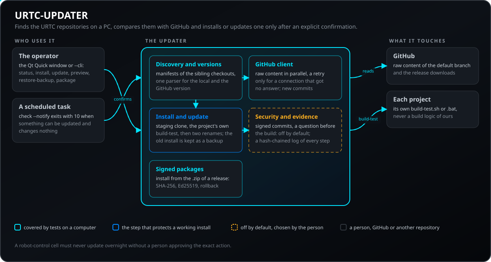
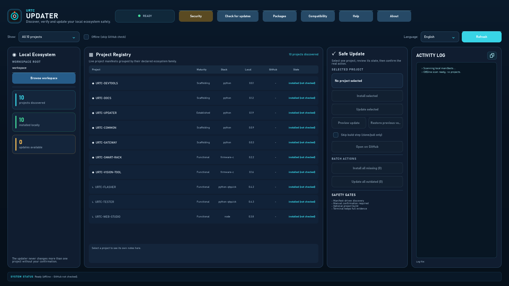
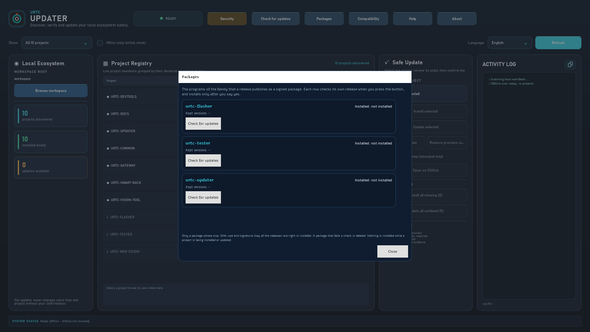
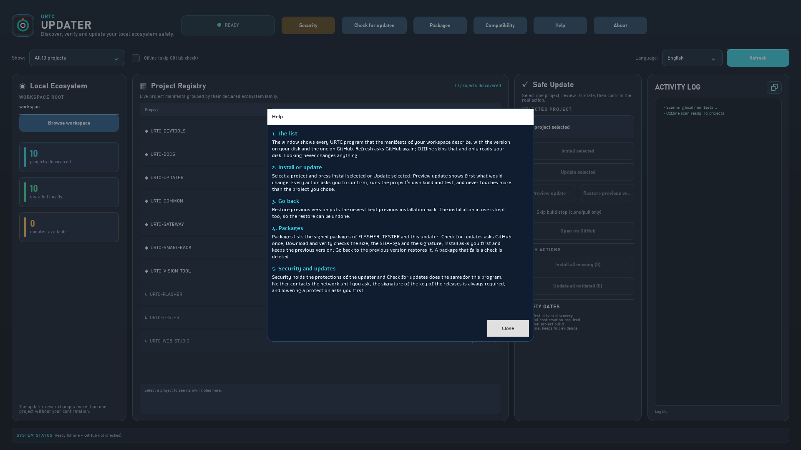
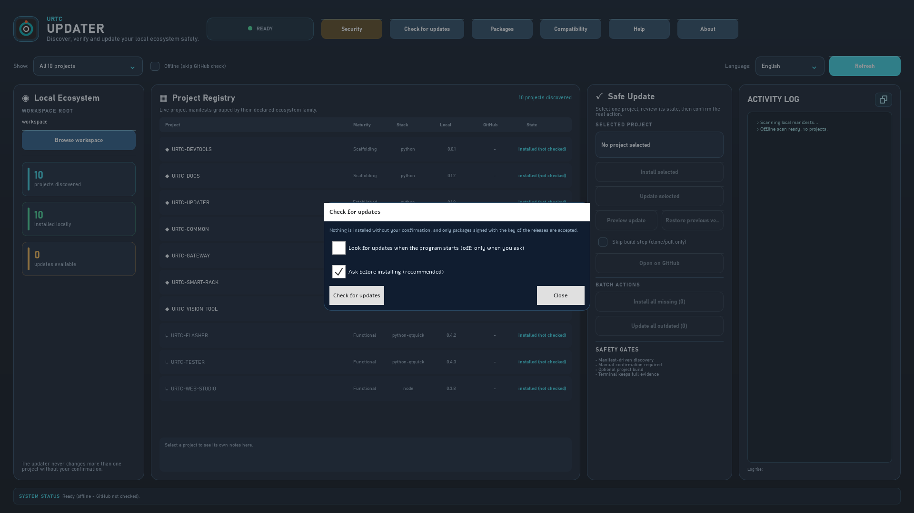
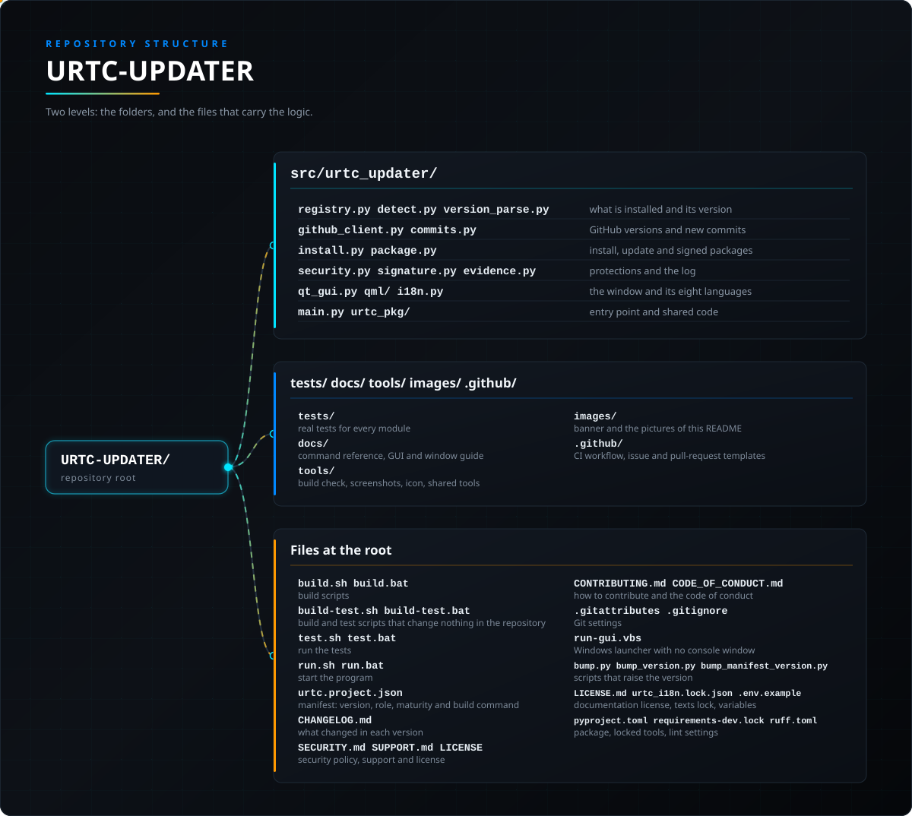

<p align="center">
  
</p>

# 🛠️ URTC-UPDATER

<p align="center"><a href="README.md">🇺🇸 English</a> | 🇪🇸 <b>Español</b> | <a href="README_fra.md">🇫🇷 Français</a> | <a href="README_ita.md">🇮🇹 Italiano</a> | <a href="README_deu.md">🇩🇪 Deutsch</a> | <a href="README_zho.md">🇨🇳 简体中文</a> | <a href="README_jpn.md">🇯🇵 日本語</a> | <a href="README_por.md">🇵🇹 Português</a></p>

### 📦 Detecta, instala y actualiza a mano todo el ecosistema URTC

<p align="center">
  
  
  
  
</p>

> **Modo visual de escritorio:** la interfaz de escritorio por defecto usa
> **Qt Quick / QML** mediante el runtime GUI opcional `PySide6`. El núcleo del
> actualizador y el modo `--cli` siguen siendo solo libreria estandar para una CM5 sin pantalla.
>
> **Inicio Windows y evidencia de actualizacion:** abre `run-gui.vbs` (o usa
> `run.bat` sin argumentos) para el cliente grafico sin consola. El panel de
> actualizacion muestra checkpoints reales de precomprobacion, origen,
> manifiesto, build-test y finalizacion con evidencia capturada; `run.bat --cli ...`
> conserva la terminal para diagnosticos.
> Instalar solo se activa si falta el checkout y Actualizar solo si GitHub es
> superior. Durante una accion aprobada, los checkpoints sustituyen los
> controles del proyecto seleccionado; otra seleccion los restaura.
> **Instalar todos los faltantes** y **Actualizar todos los desfasados** son
> acciones de lote secuenciales, confirmadas por separado y basadas en el mismo
> estado real y flujo de seguridad.

---

**Comprobación de honestidad - lo que realmente funciona hoy:** **Madurez: establecido (una ejecución completa documentada, no un uso sostenido).** Este proyecto adapta el diseño ya probado de HYDRA-UMC-UPDATER (el mismo descubrimiento por manifiesto, la instalación/actualización con clon temporal verificado de forma atómica y el registro de evidencias) solo a los repositorios del ecosistema URTC. Se ejecutó de extremo a extremo contra GitHub en un espacio de trabajo aislado: una instalación limpia y una actualización posterior de un repositorio real se clonaron, compilaron y promovieron correctamente, conservando la copia anterior como respaldo. La lógica de descubrimiento y de versiones (`registry.py`, `project_manifest.py`, `version_parse.py`, `detect.py`), el cliente de contenido raw de GitHub con reintento/backoff y listado de repositorios en caché (`github_client.py`), la comparación por commit (`commits.py`) y el pipeline de clonar-preparar-verificar-promover (`install.py`) están cubiertos por tests (`python -m pytest`), incluido un servidor HTTP de fixture local y repositorios git temporales reales con un remoto bare local. La lógica propia del puente Qt se ejecuta sin pantalla en los tests, y la ventana con sus diálogos se carga sin pantalla para comprobar que se abre y responde; su aspecto se revisa a ojo, no con un test. La cobertura de 8 idiomas de `i18n.py` se comprueba por test en cuanto a claves y marcadores, no en cuanto a calidad de la traducción. Consulta `CHANGELOG.md` para ver exactamente qué se ha entregado hasta ahora.

---

> **Estado de seguridad física y de ciberseguridad:** este ecosistema no es un sistema de seguridad certificado y todavía no existe ninguna placa URTC poblada. Los bootloaders comprueban las imágenes de firmware con CRC32 y un HMAC-SHA256 de clave compartida, no con una firma asimétrica (prevista); las imágenes de aplicación publicadas están firmadas con la clave pública de desarrollo (`signing_key_kind: dev`), así que cualquiera puede producir una imagen que el bootloader acepte; no se ha transmitido nada a una placa real. Lee la [línea base de seguridad](https://github.com/JuanenRac/URTC-DOCS/blob/main/docs/SECURITY_BASELINE.md) y el [modelo de amenazas](https://github.com/JuanenRac/URTC-DOCS/blob/main/docs/THREAT_MODEL.md) antes de fiarte de cualquier afirmación de aquí para la seguridad de una persona.

## 📋 De un vistazo

| | |
|---|---|
| Versión | `0.2.0` |
| Madurez | Establecido |
| Tests | 482 (`python -m pytest`) |
| Tecnología | Python 3.10+ / PySide6 / Qt Quick (QML) / Git / GitHub raw content |
| Destino | El PC de quien lo usa |
| En hardware real | No aplica: nada de esto se ejecuta en hardware |

**Ir a:** [Resumen](#-resumen) · [Arquitectura](#-arquitectura) · [Seguridad](#-seguridad-y-protección) · [Interfaces](#-interfaces) · [Inicio rápido](#-inicio-rápido) · [Pruebas](#-pruebas) · [Problemas](#-resolución-de-problemas) · [Estructura](#-estructura-del-repositorio) · [Relacionados](#-proyectos-relacionados)

<!-- urtc-section:status_updater -->
## 🚦 Estado del proyecto

🟢 hecho y verificado · 🟡 funciona, con límites conocidos · 🟠 a medias o sin verificar · 🔴 sin hacer o sin funcionar. Nada es verde si nunca corrió en hardware real.

| Parte | Estado | Lo que el repositorio puede demostrar |
| --- | :---: | --- |
| Software | 🟡 | Funciona en un PC y contra el simulador; nunca se ha usado con una placa real. |
| Interfaz | 🟡 | La ventana funciona y se comprueba contra una placa simulada; no se ha probado con un adaptador real. |
| Pruebas | 🟢 | La batería de pruebas pasa en la CI en cada subida. |
| Actualizaciones | 🟡 | Instala desde paquetes firmados con vuelta atrás; probado solo en un PC. |
| Seguridad | 🟡 | Las versiones se firman con Ed25519 y se comprueban antes de usarlas; el manejo de las claves no lo ha revisado nadie más. |
| Documentación | 🟡 | README en ocho idiomas y documentos de referencia; las traducciones no las ha revisado ningún hablante nativo. |

<!-- /urtc-section:status_updater -->

## 🎯 Resumen

URTC-UPDATER es una pequeña herramienta - GUI con ventana por
defecto, CLI completa con `--cli` - pensada para ejecutarse tanto en la
CM5 real como en la propia máquina Windows/Linux/macOS de un
desarrollador (cualquier workspace con el mismo tipo de checkout) que
responde a tres preguntas sobre cada otro proyecto real que descubre a
través del propio manifiesto `urtc.project.json` de cada checkout
vecino - el número en sí nunca está fijado aquí, ya que crece con el
propio ecosistema:

1. **¿Qué hay instalado aquí de verdad, y en qué versión?**
2. **¿Cuál es la última versión publicada en GitHub?**
3. **Si GitHub tiene una versión más nueva, déjame elegir un proyecto o un lote secuencial confirmado.**

Ese último punto es deliberado y no negociable: esta herramienta nunca cambia
un proyecto por iniciativa propia. Una acción sobre un proyecto seleccionado
siempre exige confirmación explícita. La GUI también puede ofrecer **Instalar
todos los faltantes** o **Actualizar todos los desfasados**; ambos son lotes
secuenciales confirmados por separado y sujetos a las mismas puertas de
manifiesto, versión y seguridad. Nunca existe actualización automática nocturna
sin una persona aprobando la acción exacta.

Tampoco todo proyecto descubierto pertenece a la CM5 en sí - la mayoría de los
repos con prefijo URTC y algunos de HYDRA-UMC son herramientas que un
desarrollador ejecuta desde su propio PC (el firmware se compila y se
flashea DESDE un puesto de trabajo, no se compila EN la célula), o apps
que se instalan en un móvil/reloj. El propio campo `deploy` de
`registry.py` registra cuál es cuál (ver sección 3), y la tabla de
proyectos de la GUI filtra por él - por defecto muestra "solo CM5" cuando
detecta que se ejecuta en Linux (el propio SO de la CM5 real), y "mostrar
todo" en Windows/macOS.

Ejemplo ilustrativo (el número exacto de proyectos y cada número de
versión de abajo están inventados para mostrar la forma de la salida,
no son una ejecución realmente capturada - el número real es siempre
el que `registry.py` descubre hoy, nunca una cifra fija en este
documento):

```
$ urtc-updater --cli status
Workspace root: /home/user/GitHub
PROJECT       MATURITY     ROLE      STACK           LOCAL     GITHUB    STATE
-------------------------------------------------------------------------------
URTC          functional   firmware  firmware-c      0.3.0     0.3.1     OUTDATED
URTC-FLASHER  functional   tool      python-qtquick  0.2.1     0.2.1     up to date
URTC-TESTER   functional   tool      python-qtquick  0.2.2     0.2.2     NEW COMMITS

3/3 installed, 1 outdated, 1 with new commits at the same version
Run `urtc-updater update <project>` to update one by hand - never automatic, see this tool's own README.

$ urtc-updater --cli update URTC
Updating URTC into /home/user/GitHub ...
OK  Updated /home/user/GitHub/URTC to v0.3.1 (commit 1a2b3c4d5e6f) after a verified build; previous installation kept at /home/user/GitHub/URTC.backup-1a2b3c4d
```

Ejecutar `urtc-updater` sin argumentos (o hacer doble clic) abre en cambio
la misma información en una superficie de control de escritorio oscura: un
panel **Local Ecosystem** con métricas de detección/instalación/actualización
en vivo, un árbol **Project Registry** guiado por manifiestos y un panel
**Safe Update** para el proyecto seleccionado. La disposición hace visibles
las protecciones reales: detección por manifiesto, una única acción explícita
sobre un proyecto, confirmación manual, compilación opcional y un registro de
actividad en pantalla; el registro completo también se escribe en un archivo
bajo `~/.urtc_updater/logs` (se conservan los 20 más recientes).

## 🧩 Papel en URTC

URTC-UPDATER es el programa que mantiene al día un PC con los repositorios de URTC. Encuentra cada proyecto junto a él por el manifiesto que lleva cada repositorio, dice qué versión está instalada y cuál tiene GitHub, e instala o actualiza un proyecto a la vez tras una confirmación explícita, ejecutando el script `build-test` de ese proyecto y sin compilar nada por sí mismo. No cambia nada por iniciativa propia: una celda de control de robots nunca debe actualizarse de madrugada sin que una persona apruebe la acción exacta. También instala los programas de escritorio (el flasheador, el tester y él mismo) desde el paquete firmado de su release, y puede entregar a URTC-FLASHER, que es quien flashea, una imagen de firmware cuya firma de release ha comprobado.

## 🏛️ Arquitectura

<p align="center">
  
</p>

Cómo encajan las partes de este repositorio: quién lo usa, qué contiene y de qué depende. La imagen se dibuja desde `docs/architecture.json` y se comprueba contra el código.

### CÓMO FUNCIONA REALMENTE UNA COMPROBACIÓN/ACTUALIZACIÓN

- **Fuente de la versión**: la versión de un proyecto vive en un archivo de código de ese proyecto (`pyproject.toml`, `Cargo.toml`, `version.go`, `package.json`, `version.properties`, `pubspec.yaml` o un `#define` de firmware, según su tecnología) que escribe su propio paso `bump.py`, y ese paso nunca ha creado una etiqueta de git ni una Release de GitHub. Por eso esta herramienta lee ese mismo archivo directamente de la rama principal del repositorio por el servidor de contenido bruto de GitHub, no por la API de Releases, que indicaría que ningún proyecto tiene releases.
- **Detección local**: para cada proyecto descubierto,
  comprueba si existe un directorio con ese nombre exacto bajo la raíz
  del workspace (la disposición estándar del ecosistema - cada proyecto
  como directorio hermano, lo mismo que ya asumen build-frontend.sh y el
  propio descubrimiento de HYDRA-UMC-SUITE), y si existe, lee su propia
  copia local de ese mismo archivo de versión.
- **Una sola implementación de parseo** (`version_parse.py`) se comparte
  entre la lectura local y la descarga de GitHub, así que un checkout
  local y una descarga de GitHub nunca se interpretan con dos regex que
  puedan desincronizarse de forma independiente.
- **Instalar/actualizar**: `git clone` (instalar) compila después como
  un paso aparte. Actualizar un checkout YA EXISTENTE es atómico por
  verificación en su lugar: el candidato se clona, se fusiona con
  fast-forward (nunca un reset forzado, así que los cambios locales
  reales fallan de forma visible en vez de descartarse), y se compila/
  verifica en un clon de staging completamente independiente PRIMERO -
  la instalación real solo se toca (mediante dos renombrados de
  directorio consecutivos, conservando la instalación anterior en
  `<nombre>.backup-xxxxxxxx`, sin borrarla) si esa compilación de staging
  realmente tiene éxito. Un fallo de compilación, un checkout divergente/
  sucio, un corte de luz o un disco lleno en cualquier momento antes de
  esa promoción final dejan la instalación anterior completamente
  intacta y operativa - ver el propio docstring de `clone_or_pull` en
  `install.py`. El propio remoto git del clon de staging se restaura al
  origen real de GitHub justo después de crearse (un clon local simple
  lo dejaría apuntando a la ruta de instalación antigua, terminando en
  silencio con todas las actualizaciones futuras una vez promovido), y
  los datos locales reales del checkout instalado (todo lo que git
  considera sin seguimiento o ignorado - `data/settings.json` y
  similares, excluyendo artefactos de build regenerables) se trasladan
  al clon de staging antes de compilar, de modo que el estado operativo
  real de un proyecto sobrevive a una actualización en vez de quedar
  varado en el checkout `.backup-xxxxxxxx` conservado. En cualquier caso esto ejecuta el `build-test.sh`/
  `build-test.bat` propio de ese proyecto (la comprobación no-versionada
  - ver sección 3) si lo tiene. Esta herramienta nunca reimplementa los
  pasos de build propios de un proyecto.

### ARQUITECTURA Y DECISIONES DE DISEÑO

- **GUI Qt Quick por defecto, `--cli` para headless.** `main.py` comprueba
  `--cli` antes de importar el runtime opcional PySide6. La CLI funciona en
  una CM5 sin pantalla ni dependencia de escritorio; sin argumentos inicia
  QML cuando esta disponible y Tkinter queda solo como fallback temporal.
- **La GUI con ventana es real y habla 8 idiomas (`i18n.py`) - `--cli` a propósito no.** Cada widget, y el texto de cada checkpoint y de cada fallo de una instalación o actualización, se muestra en el idioma elegido en un selector (en/es/fr/it/de/zh/ja/pt, portugués de Portugal para pt), tomado de una preferencia guardada o de la configuración regional del sistema. Los pasos de instalación y actualización viajan como códigos de mensaje más parámetros y solo la ventana los convierte en texto, así que un cambio de idioma los vuelve a dibujar. Los nombres de proyecto y de familia y los textos `notes`/`tech` de cada proyecto no se traducen: el manifiesto es su única fuente de verdad. La salida de `--cli` se queda en inglés a propósito, porque está pensada para scripts y tuberías.
- **`deploy` es una clasificación, no una restricción.** Tratar todo
  proyecto descubierto como "algo que pertenece a la CM5" era un error - los repos
  de firmware se compilan y se flashean DESDE un PC (la CM5 solo necesita
  el binario resultante vía CAN-OTA, nunca el código fuente de este repo),
  y varias herramientas (URTC-FLASHER, HYDRA-UMC-SUITE,
  HYDRA-UMC-TOOL-CLI, ...) están pensadas para correr en el propio puesto
  de trabajo de un operador, no dentro de la célula misma. El campo
  `deploy` de `registry.py` ("cm5" / "user-pc" / "mobile" / "wearable" / "dev-server")
  registra eso, y el filtro de la GUI lo usa como punto de partida
  razonable - nunca como una restricción dura, ya que esta misma
  herramienta también está pensada para correr en el PC de un
  desarrollador, donde todo proyecto descubierto es igual de válido de inspeccionar.
- **Sin lógica de build por stack en esta herramienta.** El ecosistema abarca varias toolchains (Python, Rust, Go, Node/TS, Android/Kotlin, Flutter, firmware ARM). Reimplementar aquí el build de cada proyecto crearía un segundo lugar que dice saber compilarlo, condenado a desviarse del script del propio proyecto. `install.py` ejecuta en su lugar el `build-test.sh` sin versionado del propio proyecto (`build-test.bat` en Windows) y falla de forma segura si una copia no lo tiene. Los scripts de build que suben la versión (`build.sh` y similares) esta herramienta nunca los ejecuta.
- **Contenido raw de GitHub, no la API de Releases.** Ver sección 2 - la
  convención de versionado de este ecosistema nunca crea un tag/release,
  así que la API de Releases sería activamente incorrecta aquí, no solo
  menos conveniente.
- **Un fallo de red transitorio recibe un reintento real; una respuesta
  definitiva nunca.** Cada petición real a GitHub (`_urlopen_with_retries`
  de `github_client.py`) reintenta hasta 3 veces con backoff, pero solo
  cuando la conexión nunca llegó a obtener respuesta alguna (DNS/timeout/
  reset). Un estado HTTP real que GitHub sí devolvió - 404, 403, 500 -
  nunca se reintenta: GitHub ya respondió, y volver a golpearlo solo
  gastaría más límite de peticiones para el mismo resultado.
- **Un catálogo remoto malformado falla de forma ruidosa; un proyecto
  malformado no.** Si el propio listado de repositorios de GitHub es
  inalcanzable o no se puede parsear, `discover_remote_projects()` lanza
  una excepción - tanto `gui.py` como `main.py` ya la capturan y caen de
  vuelta a la lista de proyectos descubierta localmente en vez de mostrar
  un escaneo roto o vacío. El manifiesto malformado de un solo
  repositorio, en cambio, se aísla en la propia lista `errors` de ese
  escaneo y nunca aborta el descubrimiento del resto - una prueba real
  con servidor de fixtures (`tests/test_github_client.py`) demuestra
  ambos caminos.
- **La CLI es explícita; los lotes de la GUI se confirman.** Los comandos
  `install`/`update` de CLI reciben un nombre de proyecto. La GUI puede ejecutar
  **Instalar todos los faltantes** o **Actualizar todos los desfasados**, pero
  solo tras una confirmación independiente y de forma secuencial a través de
  las mismas puertas de seguridad. No existe actualización automática sin
  supervisión.
- **Solo librería estándar.** `urllib` para las descargas de GitHub
  (`github_client.py`), `subprocess` para las llamadas a git/scripts de
  build (`install.py`), nada más - que una herramienta responsable de
  mantener sanas las dependencias de TODOS los demás proyectos se quede
  sin dependencias propias es deliberado.
- **Simplificación conocida:** un repositorio formado por varios binarios con versión independiente (URTC tiene cuatro: principal y esclavo, aplicación y bootloader) se sigue con UNA sola versión, la que su propio `urtc.project.json` declara en `native_version`. Eso responde a "¿está este repositorio más o menos al día?", no sustituye la comprobación de versión por componente de un flasheo.

<!-- urtc-section:updates -->
### Cómo se actualiza

Este programa puede buscar una versión más nueva de sí mismo: el botón «Buscar actualización» pregunta una vez a GitHub y ofrece un paquete firmado solo si es para tu sistema y más nuevo. Nada se comprueba ni se instala por su cuenta salvo que actives la comprobación, y una actualización necesita tu confirmación. El paquete debe coincidir con su SHA-256 y con la firma de la clave de las releases fijada en el programa; la versión anterior se conserva y se restaura sola si la nueva no arranca. `urtc-updater --cli package list|check|install|rollback` hace lo mismo desde la línea de órdenes para el flasher y el tester, y `install --file` funciona sin red.
<!-- /urtc-section:updates -->

## 🖼️ Capturas de pantalla

<!-- urtc-shots -->
Capturadas a 1920×1080 en un banco de pruebas, con datos de ejemplo y sin ninguna instalación real detrás.

<table>
<tr>
<td width="50%" valign="top"><br><sub>La ventana sobre un espacio de trabajo con la familia: cada proyecto con su madurez, pila y versión local, y las acciones de actualización segura.</sub></td>
<td width="50%" valign="top"><br><sub>La ventana de Paquetes: los programas de la familia que una versión publica como paquete firmado, cada uno comprobando su propia versión.</sub></td>
</tr>
<tr>
<td width="50%" valign="top"><br><sub>La ventana de Ayuda: los pasos para usar el programa, escritos en el idioma de la ventana.</sub></td>
<td width="50%" valign="top"><br><sub>La ventana de actualizaciones: un paquete firmado más reciente solo se instala después de que lo confirmes.</sub></td>
</tr>
</table>
<!-- /urtc-shots -->

Estas imágenes son la ventana real, dibujada sin pantalla tal como se abre (nada comprobado, nada instalado). La guía recorre la ventana, la ayuda, la ventana de actualización y la de paquetes, y las muestra en los ocho idiomas del programa.

[Guía con imágenes](docs/WINDOW_GUIDE.md)

## 🔒 Seguridad y protección

| Amenaza | Defensa |
|---|---|
| Una actualización que nadie aprobó, por ejemplo de madrugada en una celda de robots | Nada cambia por sí solo: una acción sobre un proyecto necesita confirmación explícita y un lote se confirma aparte y se ejecuta de uno en uno |
| Una actualización rota o a medias deja inutilizable una instalación que funcionaba | El candidato se clona, se fusiona en avance rápido (nunca un reinicio forzado, de modo que las ediciones locales fallan a la vista) y se compila primero en un clon de preparación; la instalación en uso solo se sustituye, con dos renombrados de carpeta, si esa compilación pasa, y la anterior se conserva como `<nombre>.backup-xxxxxxxx` |
| Una comprobación que aquí no puede ejecutarse | Un build-test que responde 75 significa que la validación no está disponible: la actualización se rechaza salvo que la persona la acepte en los ajustes |
| Un commit que nadie firmó | Una revisión sin firma válida se instala con un aviso; con `"signature_policy": "require"` se rechaza |
| Un paquete manipulado | Un paquete solo se acepta si coinciden su tamaño, su SHA-256 y su firma Ed25519 y viene de los servidores de descarga de GitHub; se instala solo tras una confirmación, nunca mientras otra instalación corre, y se puede restaurar la versión anterior |
| Se pierde el rastro de lo que se hizo | Cada instalación, actualización y restauración se anota, con hora, equipo y usuario, en un registro encadenado por hashes |

El resto de la política sigue, con las palabras del programa.

**Lo que puede responder el build-test:** el código de salida 0 significa validado y cualquier otro significa fallo, salvo el 75, que significa que la validación *no está disponible* (falta una herramienta que necesita). Así se informa y la actualización se rechaza, a no ser que la aceptes con el ajuste `validation_unavailable` en `accept` (o `URTC_UPDATER_ACCEPT_UNAVAILABLE_VALIDATION=1`). Un build-test debe dejar el árbol como lo encontró: si cambia un archivo que git sigue, el archivo vuelve al contenido confirmado antes de la promoción y los pasos dicen cuál.

**Commits firmados (solo avisa por defecto; exigirlos es opcional y está desactivado por defecto):** una revisión sin firma válida (`git verify-commit`: llavero GPG, o SSH con `"allowed_signers_file"` / `URTC_UPDATER_ALLOWED_SIGNERS`) se instala igualmente, y los pasos de la ventana y de la línea de comandos dicen que no está firmada. Con `"signature_policy": "require"` en `~/.urtc_updater_settings.json` (o `URTC_UPDATER_REQUIRE_SIGNED=1`; el antiguo `"require_signed_commits": true` significa lo mismo) el candidato - el `HEAD` de un clon nuevo o el `FETCH_HEAD` descargado de una actualización - debe pasar `git verify-commit` antes de leer su manifiesto o construir nada, y un candidato rechazado deja intacto el checkout instalado.

**Opciones de seguridad (las dos desactivadas por defecto; se cambian con el botón Seguridad de la ventana, el comando `security`, el fichero de ajustes, el entorno y la línea de comandos):** además de exigir commits firmados, el actualizador puede *preguntar antes de ejecutar la comprobación de compilación* de un candidato (`"confirm_before_build": true`, `URTC_UPDATER_CONFIRM_BUILD=1`, `--confirm-build`). Descarga y valida el candidato, muestra el proyecto, el commit, su autor, su firma y los scripts de compilación o de herramientas que cambiaron, y no ejecuta nada hasta que respondas; si no hay ventana ni terminal a quien preguntar, no ejecuta nada (`--yes` responde por los scripts). `--require-signed` / `--no-require-signed` y `--confirm-build` / `--no-confirm-build` valen para una sola ejecución, y una ejecución que desactiva una protección que los ajustes guardados tienen activada lo avisa; la ventana, y `urtc-updater --cli security --require-signed off`, piden confirmación antes de guardar un nivel más bajo. Un fichero de ajustes que existe pero no se puede leer cuenta como «firmas exigidas» hasta que se arregle o se quite. A la comprobación de compilación también se le indica `URTC_PYTHON`, el intérprete que ejecuta el actualizador, de modo que el proyecto prueba con ese Python y no con el primero que encuentre el sistema.

## 🔌 Interfaces

El programa abre la ventana Qt Quick cuando se ejecuta sin argumentos y tiene una línea de comandos completa con `--cli` (no necesita pantalla ni PySide6): `status [--offline]`, `install PROYECTO`, `update PROYECTO [--preview]`, `restore-backup PROYECTO [--list]`, `clean-backups [--keep N] [--dry-run]`, `check [--notify] [--quiet]` (código de salida 10 cuando algo se puede actualizar), `package list|check|install|rollback`, `evidence [--export FILE]` y `security`. Cada comando, opción y código de salida, con salida real, está en [docs/CLI_REFERENCE.md](docs/CLI_REFERENCE.md); la ventana se describe en [docs/QML_DESKTOP_GUI.md](docs/QML_DESKTOP_GUI.md). Qué hacen los comandos de mantenimiento y de puesto:

- **Instalaciones anteriores conservadas.** Cada actualización conserva la instalación que reemplazó en `<nombre>.backup-xxxxxxxx`. Se guardan las 2 más recientes por proyecto (`"backups_to_keep"` en `~/.urtc_updater_settings.json` cambia el número) y las más antiguas se eliminan tras una actualización correcta. `urtc-updater --cli clean-backups [--keep N] [--dry-run]` las elimina a demanda, junto con cualquier carpeta temporal oculta que haya dejado una ejecución interrumpida.
- **Opcionalmente, instalación desde el paquete firmado de una release.** `urtc-updater --cli package list|check|install|rollback` instala un programa (el flasher, el tester o este updater) desde el `.zip` / `.tar.gz` de su release, en vez de un clon y una compilación. Solo se ofrece una versión estrictamente mayor, solo desde los anfitriones de descarga de GitHub, y el paquete debe coincidir con el tamaño y el SHA-256 anunciados y con la firma Ed25519 de la clave de las releases fijada en el programa; un paquete que falla una comprobación se borra. Pregunta antes de instalar (`--yes` responde para scripts), conserva las dos últimas releases y `rollback` vuelve a la anterior. `install --file PAQUETE` funciona desde un archivo en disco con su `.sha256` y su `.sig` al lado, sin red. La ventana tiene un botón «Buscar actualización» para el propio updater con las mismas reglas; la comprobación automática al arrancar es una opción, apagada por defecto. Probado con paquetes generados en un ordenador, todavía no con una release publicada.
- **Una ventana de Paquetes y una de Ayuda.** El botón «Paquetes» lista los paquetes firmados del flasher, el tester y este actualizador: cada fila comprueba su versión cuando pulsas «Buscar actualización», descarga y verifica el paquete, pregunta antes de instalar y vuelve a la versión anterior, con las mismas reglas y opciones de seguridad que el comando `package`; no se instala nada mientras se instala o actualiza un proyecto. El botón «Ayuda» abre una guía de cinco pasos en el idioma de la ventana.
- **Restaurar una.** `urtc-updater --cli restore-backup <PROYECTO> [--backup CARPETA] [--list]` devuelve una instalación conservada a su sitio. La instalación que se reemplaza también se conserva, así que el cambio se puede deshacer. La ventana ofrece las mismas dos acciones junto a Actualizar seleccionado: Vista previa de la actualización (lo que traería, sin cambiar nada) y Restaurar versión anterior.
- **Misma versión, commits nuevos.** La versión solo cambia en un build de publicación, así que `status` también compara el commit de cada proyecto instalado con el remoto (`git ls-remote`) y muestra `NEW COMMITS` cuando GitHub tiene trabajo que la copia no tiene. La ventana muestra el mismo estado y ofrece Actualizar.
- **Mirar antes de aprobar.** `urtc-updater --cli update <PROYECTO> --preview` descarga el candidato y muestra su commit, autor, versión, estado de firma y los archivos de build o de herramientas que cambia, sin tocar la copia.
- **Solo avisar.** `urtc-updater --cli check [--notify] [--quiet]` lista lo que se podría actualizar y no cambia nada. Termina con código 10 cuando hay algo que actualizar, para que una tarea programada avise a una persona; `--notify` además muestra una notificación de escritorio.
- **Evidencias.** Cada instalación, actualización y restauración se registra con hora, equipo y usuario en `.urtc-updater/evidence.jsonl`, con cada línea encadenada a la anterior por hash. `urtc-updater --cli evidence [--export ARCHIVO]` verifica la cadena y puede exportarla como un único documento JSON.
- **Perfiles de estación.** `"profiles"` en el archivo de ajustes nombra los proyectos con los que trabaja una máquina y si se permiten lotes; `--profile NOMBRE` (o `"profile"` en los ajustes) limita `status`, `check`, `install` y `update` a él, y la ventana sigue el mismo perfil.

## 🚀 Inicio rápido

```bash
chmod +x build.sh   # una sola vez
./build.sh          # crea .venv, pip install -e ., compile-check de todo
./run.sh                                # GUI con ventana (por defecto)
./run.sh --cli status                   # qué está instalado, versión local vs. GitHub
./run.sh --cli status --offline         # lo mismo, sin comprobar GitHub
./run.sh --cli install <NOMBRE-PROYECTO> # clona + compila un proyecto aún no instalado
./run.sh --cli update  <NOMBRE-PROYECTO> # actualiza + recompila un proyecto ya instalado
```

En Windows: `build.bat`, y luego `run.bat` (GUI) / `run.bat --cli status`
/ `run.bat --cli install <nombre>` / `run.bat --cli update <nombre>`.

La GUI preferida necesita el runtime Qt opcional (`pip install -e ".[gui]"`;
`build.bat`/`build.sh` ya lo instalan). `--cli` no tiene dependencia grafica y
es la entrada correcta para una CM5 headless. Si Qt no esta disponible, la
antigua ventana Tkinter es solo un fallback de compatibilidad.

<!-- urtc-section:compatibility -->
### Requisitos y compatibilidad

Qué versiones de los programas de URTC funcionan juntas, y qué versión del protocolo habla cada una, figura en la tabla de compatibilidad que genera URTC-COMMON: [docs/COMPATIBILITY.md](https://github.com/JuanenRac/URTC/blob/main/docs/COMPATIBILITY.md).
<!-- /urtc-section:compatibility -->

## 🧪 Pruebas

La suite tiene 482 pruebas (`QT_QPA_PLATFORM=offscreen python -m pytest tests -q`; algunas se omiten si falta una dependencia opcional): el descubrimiento y los manifiestos, el analizador de versiones único, el cliente de GitHub contra un servidor local (reintentos, errores, un catálogo mal formado), instalación y actualización sobre repositorios git locales reales (preparación, promoción, copia de seguridad, rechazos, un build-test que responde 75, seguridad del espacio de trabajo), restaurar y limpiar copias, la política de commits firmados, las opciones de seguridad, los paquetes firmados y su reversión, la cadena de evidencias, los ajustes y perfiles, los textos de la ventana en los ocho idiomas y el puente de Qt, y las imágenes de la guía de la ventana, dibujadas sin pantalla. `python -m mypy` y `ruff check .` se ejecutan en la CI.

## 🏗️ Compilación y publicación

`build.sh` / `build.bat` crean el `.venv`, instalan el paquete (`pip install -e .`, con el entorno de Qt para la ventana) y comprueban la compilación de todo; `build-test.sh` / `build-test.bat` comprueban sin instalar; `run.sh` / `run.bat` abren la ventana, o la línea de comandos con `--cli`; `run-gui.vbs` la abre en Windows sin ventana de consola. Todavía no se construye un ejecutable independiente.

## 🩺 Resolución de problemas

- `status` muestra `?` en la versión de GitHub de un proyecto: no se pudo leer GitHub para él. La columna STATE dice por qué (por ejemplo `installed, GitHub unknown (HTTP 404)` o un aviso de límite de peticiones).
- `status` muestra `-` en GitHub sin ningún error: ejecuta `status` (sin
  `--offline`) - `-` solo aparece cuando la comprobación de GitHub se
  omitió por completo.
- `install`/`update` falla con "No non-versioning build-test.sh/.bat found": esa copia no tiene `build-test.sh` (`build-test.bat` en Windows). Actualiza el propio proyecto o verifícalo a mano; esta herramienta nunca ejecuta en su lugar un script de build que suba la versión.
- `git pull --ff-only` falla: el checkout local tiene cambios sin
  commitear o el historial ha divergido - resuélvelo a mano (`git
  status` dentro del propio directorio del proyecto) antes de reintentar
  `update`. Esta herramienta nunca fuerza un reset de un checkout.

## 📂 Estructura del repositorio

<p align="center">
  
</p>

<details>
<summary>Versión en texto del árbol</summary>

```text
URTC-UPDATER/
├── src/urtc_updater/                                  el programa: descubrimiento, versiones, instalación y actualización, seguridad, paquetes firmados, la ventana Qt Quick y sus textos en ocho idiomas
├── tests/                                             pruebas reales de cada módulo
├── docs/                                              referencia de comandos, interfaz y guía de la ventana
├── tools/                                             comprobación de compilación, capturas, icono y herramientas compartidas
├── images/                                            banner e imágenes de este README
├── .github/                                           flujo de CI y plantillas de issues y pull requests
├── build.sh build.bat                                 scripts de compilación
├── build-test.sh build-test.bat                       scripts de compilación y pruebas que no cambian nada en el repositorio
├── test.sh test.bat                                   ejecutan las pruebas
├── run.sh run.bat                                     arrancan el programa
├── urtc.project.json                                  manifiesto: versión, papel, madurez y comando de compilación
├── CHANGELOG.md                                       qué cambió en cada versión
├── SECURITY.md SUPPORT.md LICENSE                     política de seguridad, soporte y licencia
├── CONTRIBUTING.md CODE_OF_CONDUCT.md                 cómo contribuir y código de conducta
├── .gitattributes .gitignore                          ajustes de Git
├── run-gui.vbs                                        lanzador de Windows sin ventana de consola
├── bump.py bump_version.py bump_manifest_version.py   scripts que suben la versión
├── urtc_i18n.lock.json                                bloqueo de los textos de la ventana
├── LICENSE.md .env.example                            licencia de la documentación y variables
└── pyproject.toml requirements-dev.lock ruff.toml     paquete, herramientas fijadas, ajustes de lint y el bloqueo de los textos
```

</details>

La lista anotada de cada archivo de código, una línea por archivo, está en [docs/SOURCE_MAP.md](docs/SOURCE_MAP.md).

## 🗺️ Hoja de ruta y límites conocidos

- Un ejecutable de GUI independiente empaquetado (PyInstaller, siguiendo
  la propia convención `build_exe.bat`/`.sh` de HYDRA-UMC-SUITE) para una
  instalación con doble clic sin ningún paso de `pip`/venv - hoy la GUI
  todavía necesita `./build.sh` primero, igual que la CLI.
- Comprobación previa opcional de dependencias por proyecto (avisar de
  toolchains faltantes - sin Rust/Go/SDK de Android/Flutter instalado -
  antes de que un `install` falle a mitad de camino).
- Seguimiento por componente para el firmware multi-binario propio de
  HYDRA-UMC/URTC (ver la "simplificación conocida" de la sección 3), en
  cuanto haya una necesidad real más allá del único componente
  representativo que se sigue hoy.

## 🌍 Idiomas

El README y los textos existen en inglés, español, francés, italiano, alemán, chino, japonés y portugués de Portugal.

## 🔗 Proyectos relacionados

URTC se compone de repositorios independientes, cada uno con su versión, sus pruebas y su README. Esta es la familia, por grupos:

* **URTC Tool Platform:**
  * [URTC](https://github.com/JuanenRac/URTC) - firmware de la placa del cabezal de herramienta (25 perfiles de herramienta, bootloader CAN) y la referencia del protocolo CAN.
  * [URTC-COMMON](https://github.com/JuanenRac/URTC-COMMON) - el protocolo CAN escrito una sola vez como datos (especificación, tablas generadas, vectores de conformidad) y el código que comparten los programas.
  * [URTC-FLASHER](https://github.com/JuanenRac/URTC-FLASHER) - herramienta de escritorio que actualiza el firmware de la placa por CAN o por SWD/JTAG.
  * [URTC-GATEWAY](https://github.com/JuanenRac/URTC-GATEWAY) - pasarela delante del bus CAN: solo deja pasar los identificadores de una lista, limita su frecuencia y pide una clave de sesión.
  * [URTC-SMART-RACK](https://github.com/JuanenRac/URTC-SMART-RACK) - lógica en C independiente del hardware y protocolo de órdenes para un soporte de herramientas con precalentamiento y seguimiento del ciclo de vida.
  * [URTC-TESTER](https://github.com/JuanenRac/URTC-TESTER) - probador de escritorio del bus CAN en vivo que muestra los controles y la telemetría del perfil de herramienta que informa una placa.
  * [URTC-VISION-TOOL](https://github.com/JuanenRac/URTC-VISION-TOOL) - protocolo de tramas de sensor en C y un acompañante en Python térmico/RGB para un cabezal de inspección.
  * [URTC-WEB-STUDIO](https://github.com/JuanenRac/URTC-WEB-STUDIO) - aplicación de navegador que graba y prueba la placa por Web Serial y SLCAN, sin instalar nada.
* **Ecosystem Operations:**
  * [URTC-DEVTOOLS](https://github.com/JuanenRac/URTC-DEVTOOLS) - las herramientas de repositorio compartidas de la familia como un conjunto con versión y un fichero de bloqueo que distingue una copia editada de una desfasada.
  * [URTC-DOCS](https://github.com/JuanenRac/URTC-DOCS) - arquitectura, interfaces, línea base de seguridad y catálogo generado del ecosistema, más las herramientas que comparan todos los repositorios.
  * **URTC-UPDATER** (este repositorio) - herramienta de escritorio que detecta, instala y actualiza los repositorios de la familia URTC, una acción explícita cada vez.

**Proyectos hermanos (independientes, con la misma base y herramientas):**

* **[HYDRA-UMC-DOCS](https://github.com/JuanenRac/HYDRA-UMC-DOCS)** - proyecto hermano: el centro de documentación de HYDRA-UMC, un ecosistema independiente que comparte base y herramientas con este
* **[ARMOR-DOCS](https://github.com/JuanenRac/ARMOR-DOCS)** - proyecto hermano: el centro de documentación de A.R.M.O.R., el ecosistema de seguridad, también independiente y sobre la misma base
* **[JuanenRac](https://github.com/JuanenRac/JuanenRac)** - el perfil y el panel de estado de todos los ecosistemas

## 📚 Documentación

* **[docs/CLI_REFERENCE.md](docs/CLI_REFERENCE.md)** — cada subcomando de `--cli`, salida real capturada de una instalacion real, y el contrato de codigos de salida.
* **[docs/QML_DESKTOP_GUI.md](docs/QML_DESKTOP_GUI.md)** — como esta estructurado el cliente de escritorio Qt Quick/QML, y como sigue siendo una superficie de control real sobre el mismo backend que usa `--cli`, no una segunda implementacion.
* **[Historial de cambios de este repositorio](CHANGELOG.md)**
* Preguntas, ideas e informes: electrohobby3d@gmail.com

## 🤝 Contribuir y comunidad

* Antes de una pull request ejecuta `URTC_CI=1 python tools/ci_validate.py`: debe pasar. Consulta [CONTRIBUTING.md](CONTRIBUTING.md) y el [código de conducta](CODE_OF_CONDUCT.md).
* El README existe en ocho idiomas: un cambio en el texto se hace en los ocho archivos, y las secciones compartidas con otros repositorios las escribe `tools/readme_sections.py` de URTC-COMMON.
* Un cambio en el protocolo CAN empieza en URTC-COMMON (`spec/can_protocol.json`) y llega a este repositorio mediante la copia comprobada.
* No describas como funcionando en una placa lo que solo se ha compilado.
* Informa de una vulnerabilidad en privado: [SECURITY.md](SECURITY.md). Preguntas, ideas e informes: electrohobby3d@gmail.com ([SUPPORT.md](SUPPORT.md)).

## 👤 AUTOR

**JuanenRac** (Electro Hobby 3D)
📧 electrohobby3d@gmail.com
📺 [youtube.com/@electrohobby3d](https://youtube.com/@electrohobby3d)

## 📜 LICENCIA

GPL-3.0-or-later - ver [LICENSE](LICENSE).
