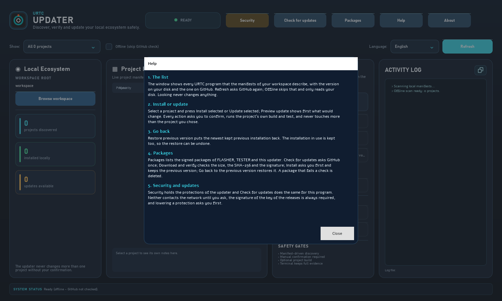
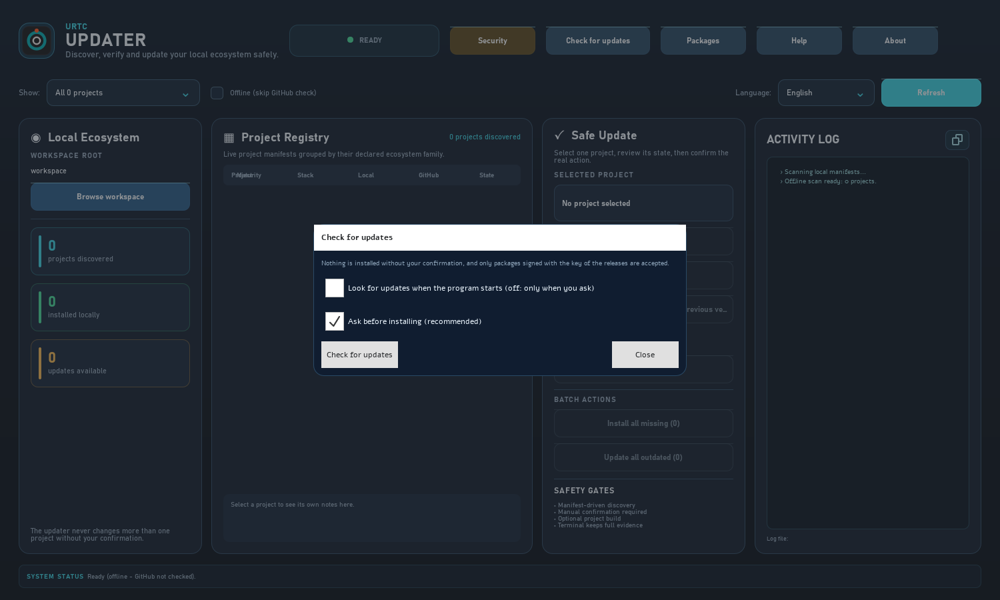
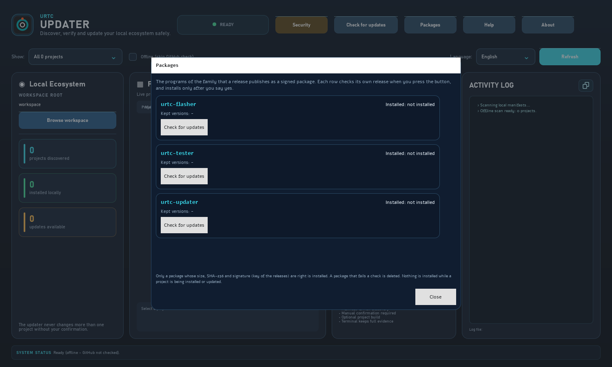

<!--
=============================================================================
URTC-UPDATER - docs/WINDOW_GUIDE.md
Copyright (C) 2026 JuanenRac (Electro Hobby 3D) <electrohobby3d@gmail.com>
GPL-3.0-or-later - see LICENSE
=============================================================================
-->

# The window of the updater, step by step

These pictures are the real window, loaded without a screen and drawn to a file by `tools/capture_screens.py` (`python tools/capture_screens.py` writes them again). They show the program as it opens with the box **Offline** ticked, looking at an empty workspace: nothing is checked on GitHub, nothing is installed, and the language is English. The same texts exist in the eight languages of the program, and the **Help** button of the window shows the quick guide in the language you chose.

## 1. The window as it opens

* **Local Ecosystem** (left): the folder the updater looks at (**Browse workspace** changes it) and three counters: the URTC projects it found, the ones installed in that folder and the ones with an update. The first run shows zeros: the folder has no project in it yet.
* **Project Registry** (centre): one row per project whose manifest it found, with its stack, the version on disk and the version on GitHub. The notes of the selected project are below the table.
* **Safe Update** (right): choose a project, then **Install selected**, **Update selected**, **Preview update** (what would change, without changing it) or **Restore previous version**. Nothing runs without a confirmation, and an update never touches more than the one project you selected. The batch buttons below act on every missing or outdated project, and ask first.
* **Activity Log** (far right): every step the updater took, also written to a file.
* **Security** shows and changes the protections: signed commits, the question before the build of a project. **Refresh** looks again; with **Offline** ticked it only reads the disk.

## 2. Help

The **Help** button opens five short steps in the language of the window: the overview, installing and updating, going back, the packages and the security of updates.

## 3. Check for updates

**Check for updates** is about the updater itself. It asks GitHub once, only when you press it. Both options are conservative: the check at start is off, and an update is installed only after you confirm it and only if the signature of the package matches the key of the releases pinned in the program; the previous version is kept so you can go back.

## 4. Packages

**Packages** lists the programs of the family that a release publishes as a signed package (the flasher, the tester and the updater). Each row shows the installed version and the versions kept, and checks its own release only when you press its button. A package is installed only if its size, its SHA-256 and its signature are right, and the installation asks first; a package that fails a check is deleted, and going back to the previous version asks a second time. Nothing is installed while a project is being installed or updated.

## The same pictures in the other languages

The program has eight interface languages. These are the same four pictures taken with each of them (`python tools/capture_screens.py --all-languages` writes them again; `--language german` writes one language). The texts are those of the program, not of this page, so a picture shows exactly what a person who chose that language sees.

| Language | Window | Help | Updates | Packages |
|---|---|---|---|---|
| English | [window](screenshots/updater-deck.png) | [help](screenshots/updater-help.png) | [updates](screenshots/updater-updates.png) | [packages](screenshots/updater-packages.png) |
| Español | [window](screenshots/updater-deck-es.png) | [help](screenshots/updater-help-es.png) | [updates](screenshots/updater-updates-es.png) | [packages](screenshots/updater-packages-es.png) |
| Deutsch | [window](screenshots/updater-deck-de.png) | [help](screenshots/updater-help-de.png) | [updates](screenshots/updater-updates-de.png) | [packages](screenshots/updater-packages-de.png) |
| Français | [window](screenshots/updater-deck-fr.png) | [help](screenshots/updater-help-fr.png) | [updates](screenshots/updater-updates-fr.png) | [packages](screenshots/updater-packages-fr.png) |
| Italiano | [window](screenshots/updater-deck-it.png) | [help](screenshots/updater-help-it.png) | [updates](screenshots/updater-updates-it.png) | [packages](screenshots/updater-packages-it.png) |
| 日本語 | [window](screenshots/updater-deck-ja.png) | [help](screenshots/updater-help-ja.png) | [updates](screenshots/updater-updates-ja.png) | [packages](screenshots/updater-packages-ja.png) |
| 简体中文 | [window](screenshots/updater-deck-zh.png) | [help](screenshots/updater-help-zh.png) | [updates](screenshots/updater-updates-zh.png) | [packages](screenshots/updater-packages-zh.png) |
| Português | [window](screenshots/updater-deck-pt.png) | [help](screenshots/updater-help-pt.png) | [updates](screenshots/updater-updates-pt.png) | [packages](screenshots/updater-packages-pt.png) |

## What the pictures do not show

They do not show a project being installed or a release being checked: the workspace is empty and the network is not used. Nothing in this guide has been run against a real release package; the README lists what has and has not been checked.
